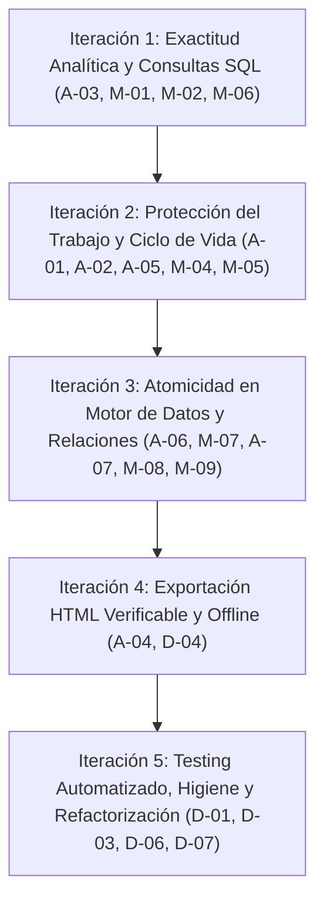

# 🛠️ Plan de Intervención e Iteraciones — Analyticraft v0.8.4
## Saneamiento de Deuda Técnica, Exactitud Analítica y Resiliencia de Ciclo de Vida

**Fecha de Creación:** 2026-10-26  
**Documento Base de Auditoría:** [`auditoria_bugs_deuda_tecnica_2026-10-26.md`](./auditoria_bugs_deuda_tecnica_2026-10-26.md)  
**Versión de Partida:** `v0.8.3`  
**Versión Objetivo:** `v0.8.4` (Hito previo al desarrollo del lienzo libre en `v0.9.0`)  
**Filosofía de Ejecución:** *Zero Slop*, control de radio de impacto (*Blast Radius*), TDD con Vitest en flujos críticos y preservación estricta del principio *Local-First*.

---

## 🎯 Objetivos Estratégicos de la Versión 0.8.4

1. **Exactitud Analítica Indiscutible:** Eliminar conversiones erróneas a texto en comparaciones numéricas (`>`, `<`), ordenar series temporales de manera cronológica y garantizar precisión de tipos enteros grandes (`bigint`).
2. **Protección Total del Trabajo del Usuario:** Garantizar que ninguna mutación de visuales o filtros pase desapercibida por el indicador de cambios (`isDirty`), blindar la apertura/reinicio de proyectos para evitar estados híbridos y convertir las operaciones de guardado y reemplazo en caliente (*Hot Swap*) en transacciones atómicas.
3. **Exportación 100% Autocontenida y Fidedigna:** Exportar dashboards esperando la resolución de consultas activas, con el nombre real del proyecto y con recursos embebidos capaces de funcionar sin conexión a internet.
4. **Gobernanza de Código y Testing:** Expandir la suite de pruebas unitarias con Vitest cubriendo consultas DuckDB, validación de esquemas y transiciones de estado, desincorporando dependencias en desuso (`papaparse`).

---

## 📅 Desglose en 5 Iteraciones de Trabajo

---

### 🟢 Iteración 1: Exactitud Analítica y Corrección de Consultas SQL
> **Foco:** Corregir la generación de consultas en DuckDB para que las métricas, filtros y ordenamientos reflejen la verdad matemática de los datos.

#### Tareas Técnicas:
- [ ] **IT1.1 (A-03) Filtros Numéricos Tipados en `ChartCard.tsx`:**
  - *Problema:* Actualmente se ejecuta `CAST("col" AS VARCHAR) > 'val'`, provocando que `'10' < '2'` evalúe como verdadero.
  - *Solución:* Conservar el tipo original de la columna inferido por DuckDB. Aplicar `CAST(... AS DOUBLE)` o numérico para columnas `#` y reservar `VARCHAR` exclusivamente para comparaciones de texto o `LIKE`.
  - *Archivos:* `src/components/ChartCard.tsx`.
  - *Prueba Vitest:* `tests/sqlFilters.test.ts` evaluando comparaciones con números negativos, decimales y escalas `[2, 10, 100]`.

- [ ] **IT1.2 (M-01) Ordenamiento Cronológico en Series Temporales (Líneas y Áreas):**
  - *Problema:* Las consultas usan `ORDER BY metric DESC` universalmente, destruyendo la secuencia temporal de gráficos de líneas y áreas.
  - *Solución:* En gráficos de líneas (`line`) y áreas (`area`), aplicar `ORDER BY dim ASC` cuando la dimensión sea temporal o categórica secuencial. Mantener `ORDER BY metric DESC` para gráficos de barras, donas y tablas.
  - *Archivos:* `src/components/ChartCard.tsx`.
  - *Prueba Vitest:* Validar generación de cláusula `ORDER BY` en base al tipo de visual.

- [ ] **IT1.3 (M-02) Preservación Segura de `bigint`:**
  - *Problema:* `Number(val)` pierde precisión cuando los enteros superan `Number.MAX_SAFE_INTEGER` (9,007,199,254,740,991).
  - *Solución:* Implementar helper `safeNumericValue(val: unknown): number | string` en `src/lib/duckdb.ts` que preserve identificadores como `string` o lance advertencia/notificación si una métrica cuantitativa sobrepasa el rango seguro.
  - *Archivos:* `src/lib/duckdb.ts`.

- [ ] **IT1.4 (M-06) Búsqueda No Truncada en Segmentadores:**
  - *Problema:* La query del segmentador aplica `LIMIT 50` antes de filtrar, imposibilitando buscar valores fuera de los primeros 50 más frecuentes.
  - *Solución:* Incorporar búsqueda interactiva reactiva en DuckDB `SELECT DISTINCT dim FROM table WHERE dim ILIKE '%search%' LIMIT 50`.
  - *Archivos:* `src/components/ChartCard.tsx`.

---

### 🟡 Iteración 2: Protección del Trabajo del Usuario y Ciclo de Vida
> **Foco:** Impedir la pérdida silenciosa de trabajo y evitar la corrupción de proyectos por mezcla de estados antiguos.

#### Tareas Técnicas:
- [ ] **IT2.1 (A-01) Centralización de Mutaciones y Reactividad de `isDirty`:**
  - *Problema:* Operaciones como `updateSelectedChart`, cambio de tema, asignaciones Drag & Drop y edición de filtros no activan `setIsDirty(true)`.
  - *Solución:* Crear una función despachadora unificada `mutateProject(updater: (prev: Project) => Project)` que registre de forma centralizada la mutación, invoque `setIsDirty(true)` y registre el snapshot en el historial Undo/Redo.
  - *Archivos:* `src/App.tsx`.
  - *Prueba Vitest:* Verificar que cada acción de edición active la bandera `isDirty`.

- [ ] **IT2.2 (A-02) Carga Segura y Aislada de Proyectos (`loadProject` Unificado):**
  - *Problema:* Abrir proyectos no confirma cambios pendientes y, si faltan CSVs, conserva tablas del proyecto anterior produciendo estados híbridos.
  - *Solución:* Unificar `loadProjectFromFile` y `handleOpenProjectDirectory` en un pipeline estricto:
    1. Si `isDirty === true`, solicitar confirmación modal al usuario.
    2. Validar esquema JSON del archivo entrante (validación runtime).
    3. Ejecutar `resetDuckDBSession()` y vaciar completamente `tables`, `charts`, `relations`, `selectedChartId` y `chartDataStore`.
    4. Cargar nuevas fuentes y relaciones de forma atómica; si alguna falla, restaurar snapshot o notificar error claro sin dejar estado a medio camino.
  - *Archivos:* `src/App.tsx`, `src/lib/projectStorage.ts`.

- [ ] **IT2.3 (A-05) Guardado con Reporte Fidedigno de Estado:**
  - *Problema:* Fallos en backups o CSVs se ignoran con `console.warn` y se devuelve `success: true`.
  - *Solución:* Hacer que `saveProjectDirectory` distinga fallos de disco/permisos y devuelva `{ success: boolean, errors?: string[] }`. Informar claramente en la UI si el respaldo no se pudo crear en lugar de reportar éxito ciego.
  - *Archivos:* `src/lib/projectStorage.ts`.

- [ ] **IT2.4 (M-04 & M-05) Sincronización de Coordenadas y Diálogos:**
  - *Problema:* `positions` en `ModelView` y `nameInput` en `SaveProjectModal` retienen estados de proyectos anteriores por montajes estáticos.
  - *Solución:* Utilizar `useEffect` con dependencias en `savedPositions`, `isOpen` y `projectName` para forzar la sincronización de props al abrir el modal o cambiar de proyecto.
  - *Archivos:* `src/components/ModelView.tsx`, `src/components/SaveProjectModal.tsx`.

---

### 🟠 Iteración 3: Atomicidad en Motor de Datos y Relaciones
> **Foco:** Eliminar condiciones de carrera, inconsistencias transaccionales y desconexiones entre el modelo lógico y el catálogo visual.

#### Tareas Técnicas:
- [ ] **IT3.1 (A-06) Reemplazo en Caliente (Hot Swap) Atómico:**
  - *Problema:* Se elimina la tabla en DuckDB antes de verificar si el nuevo CSV es válido; si falla, se pierde la tabla.
  - *Solución:*
    1. Cargar el CSV entrante en una tabla temporal `__temp_swap_tableName`.
    2. Comprobar que compila y que el esquema es compatible con los gráficos existentes.
    3. Ejecutar reemplazo transaccional `DROP TABLE tableName; ALTER TABLE __temp_swap_tableName RENAME TO tableName;`.
    4. Actualizar la caché de datos solo tras la confirmación exitosa del reemplazo.
  - *Archivos:* `src/lib/duckdb.ts`, `src/App.tsx`.

- [ ] **IT3.2 (M-07) Edición Atómica de Relaciones:**
  - *Problema:* Se ejecuta `DROP VIEW` sobre la vista existente antes de verificar la nueva relación.
  - *Solución:* Crear la nueva vista con nombre temporal; solo si se crea con éxito, se descarta la vista previa y se renombra. Ante cualquier fallo, la vista original permanece intacta.
  - *Archivos:* `src/App.tsx`, `src/lib/duckdb.ts`.

- [ ] **IT3.3 (A-07) Integración de Vistas Relacionales en el Catálogo de Visualización:**
  - *Problema:* Las vistas generadas por relaciones (`view_s_t`) no se agregan a la lista de `tables`, impidiendo arrastrar sus columnas combinadas a gráficos o paneles.
  - *Solución:* Incluir las vistas relacionales activas en el store de tablas de `FieldsPanel` y selectores de `VisualizationsPanel` (diferenciadas visualmente con icono de vista/unión).
  - *Archivos:* `src/components/FieldsPanel.tsx`, `src/components/VisualizationsPanel.tsx`, `src/App.tsx`.

- [ ] **IT3.4 (M-08 & M-09) Control de Concurrencia y Orden Determinista en Data View:**
  - *Problema:* Consultas asíncronas de paginación llegan desordenadas y `SELECT * ... LIMIT ... OFFSET ...` no tiene `ORDER BY`.
  - *Solución:* Agregar token de petición / `AbortController` para descartar respuestas desfasadas, y aplicar un orden determinista por defecto (primera columna o identificador de fila).
  - *Archivos:* `src/App.tsx`.

---

### 🔵 Iteración 4: Exportación HTML Verificable y Funcionamiento Offline
> **Foco:** Cumplir estrictamente la promesa de autonomía y funcionamiento sin conexión a internet.

#### Tareas Técnicas:
- [ ] **IT4.1 (A-04) Espera Activa de Consultas y Título Dinámico en Exportador:**
  - *Problema:* Si una tarjeta está en recarga, se exporta con datos vacíos `[]`, y el título siempre es `"Analyticraft Dashboard"`.
  - *Solución:* En `handleExportHTML`, verificar que todas las tarjetas posean sus datos consolidados. Si alguna consulta está pendiente, esperar su resolución antes de generar el archivo. Tomar `projectName` dinámicamente como título del documento.
  - *Archivos:* `src/App.tsx`, `src/lib/exporter.ts`.

- [ ] **IT4.2 (D-04) Recursos Embebidos para Exportación Offline:**
  - *Problema:* El HTML exportado enlaza a CDNs externas para ECharts y fuentes.
  - *Solución:* Incrustar ECharts minificado localmente en el empaquetado del archivo HTML exportado o proporcionar bundle autocontenido con fuentes fallback del sistema (`system-ui, -apple-system, sans-serif`).
  - *Archivos:* `src/lib/exporter.ts`.
  - *Prueba Vitest:* Prueba que valida que el HTML generado no contenga enlaces `http://` ni `https://` obligatorios para su renderizado básico.

---

### 🟣 Iteración 5: Testing Automatizado, Higiene y Refactorización
> **Foco:** Asegurar la base de código con pruebas automáticas, retirar paquetes obsoletos y preparar la arquitectura para la Fase 9.

#### Tareas Técnicas:
- [ ] **IT5.1 (D-01) Ampliación de Suite Vitest:**
  - Incorporar pruebas unitarias para:
    - Generación de filtros numéricos vs categóricos (`tests/sqlFilters.test.ts`).
    - Validación de orden cronológico en series temporales (`tests/chartOptions.test.ts`).
    - Validación de esquemas de proyecto (`tests/projectStorage.test.ts`).
    - Integridad de mutaciones y marcado de `isDirty`.
  - *Comando:* `npm test` debe ejecutar todas las suites con 100% de éxito.

- [ ] **IT5.2 (D-06) Limpieza de Dependencias:**
  - Desinstalar `papaparse` y `@types/papaparse` del `package.json` ya que DuckDB-Wasm procesa los CSVs directamente mediante `read_csv_auto`.
  - Corregir referencias en `README.md`.
  - *Comando:* `npm uninstall papaparse @types/papaparse`.

- [ ] **IT5.3 (D-07) Configuración de Seguridad Desktop (CSP):**
  - Configurar Content Security Policy estricta en `src-tauri/tauri.conf.json` permitiendo únicamente `default-src 'self'; script-src 'self' 'wasm-unsafe-eval'; worker-src 'self' blob:; style-src 'self' 'unsafe-inline';`.
  - *Archivos:* `src-tauri/tauri.conf.json`.

- [ ] **IT5.4 (D-02) Desacoplamiento Progresivo de `App.tsx`:**
  - Extraer hooks especializados:
    - `useProjectLifecycle`: Lógica de apertura, guardado, `isDirty` y backups.
    - `useDuckDB`: Gestión de conexiones, consultas de tarjetas e introspección.
  - Reducir el tamaño monolítico de `App.tsx` sin alterar contratos de componentes ni disparar regresiones.

---

## 📋 Matriz de Trazabilidad: Hallazgos vs. Tareas del Plan

| Código de Auditoría | Clasificación | Iteración Asignada | Tarea Técnica | Archivos Principales Afectados |
|---|---|---|---|---|
| **A-01** | Alta | Iteración 2 | IT2.1 | `src/App.tsx` |
| **A-02** | Alta | Iteración 2 | IT2.2 | `src/App.tsx`, `src/lib/projectStorage.ts` |
| **A-03** | Alta | Iteración 1 | IT1.1 | `src/components/ChartCard.tsx` |
| **A-04** | Alta | Iteración 4 | IT4.1, IT4.2 | `src/App.tsx`, `src/lib/exporter.ts` |
| **A-05** | Alta | Iteración 2 | IT2.3 | `src/lib/projectStorage.ts` |
| **A-06** | Alta | Iteración 3 | IT3.1 | `src/lib/duckdb.ts`, `src/App.tsx` |
| **A-07** | Alta | Iteración 3 | IT3.3 | `src/components/FieldsPanel.tsx`, `src/components/VisualizationsPanel.tsx` |
| **M-01** | Media | Iteración 1 | IT1.2 | `src/components/ChartCard.tsx` |
| **M-02** | Media | Iteración 1 | IT1.3 | `src/lib/duckdb.ts` |
| **M-03** | Media | Iteración 2 | IT2.2 | `src/lib/projectStorage.ts` |
| **M-04** | Media | Iteración 2 | IT2.4 | `src/components/ModelView.tsx` |
| **M-05** | Media | Iteración 2 | IT2.4 | `src/components/SaveProjectModal.tsx` |
| **M-06** | Media | Iteración 1 | IT1.4 | `src/components/ChartCard.tsx` |
| **M-07** | Media | Iteración 3 | IT3.2 | `src/App.tsx`, `src/lib/duckdb.ts` |
| **M-08** | Media | Iteración 3 | IT3.4 | `src/App.tsx` |
| **M-09** | Media | Iteración 3 | IT3.4 | `src/App.tsx` |
| **D-01** | Deuda | Iteración 5 | IT5.1 | `tests/*.test.ts` |
| **D-02** | Deuda | Iteración 5 | IT5.4 | `src/App.tsx`, `src/hooks/` |
| **D-03** | Deuda | Transversal | IT2.3, IT3.1 | `src/lib/projectStorage.ts`, `src/lib/duckdb.ts` |
| **D-04** | Deuda | Iteración 4 | IT4.2 | `src/lib/exporter.ts`, `src/lib/duckdb.ts` |
| **D-06** | Deuda | Iteración 5 | IT5.2 | `package.json`, `README.md` |
| **D-07** | Deuda | Iteración 5 | IT5.3 | `src-tauri/tauri.conf.json` |

---

## 🚦 Criterios de Aceptación para el Cierre de la Versión 0.8.4

1. **Pruebas Automatizadas:** `npm test` ejecuta y aprueba al menos **25 pruebas unitarias** (incluyendo nuevas pruebas de filtros SQL, ordenamiento cronológico y exportación).
2. **Cero Regresiones de Compilación:** `npm run build` compila con 0 errores TypeScript y empaqueta el bundle Vite limpiamente.
3. **Exactitud Numérica Comprobada:** Comparaciones con filtros `>` y `<` en números negativos, decimales y escalas `10 vs 2` arrojan los registros correctos en DuckDB.
4. **Resiliencia de Proyecto:** Modificar cualquier visual enciende inmediatamente el indicador de cambios `*`; abrir un nuevo proyecto solicita confirmación si hay cambios pendientes y purga el 100% del estado previo.
5. **Higiene de Dependencias:** `papaparse` queda eliminado del árbol de dependencias de producción.
