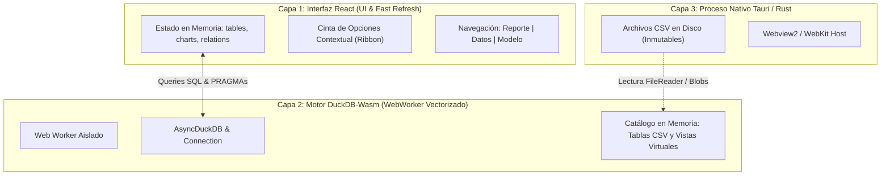

# 🛠️ Página 12: Guía de Diagnóstico Rápido y Resolución Ágil de Errores (Troubleshooting y Depuración para Desarrolladores y LLMs)

Esta guía técnica constituye el protocolo oficial de **detección, diagnóstico de causa raíz y resolución ágil de incidencias** en **Analyticraft**. Está diseñada tanto para desarrolladores como para agentes de inteligencia artificial (LLMs) que colaboren en el mantenimiento y evolución del software.

---

## 1. Arquitectura de Tres Capas y Puntos Críticos de Falla

Analyticraft funciona sobre tres subsistemas reactivos que interactúan de forma asíncrona:



### El "Triángulo de Desincronización":
Cuando ocurre un error visual o de datos, casi siempre se debe a una **ruptura de sincronización** entre el estado retenido por React y el estado de la base de datos en memoria en DuckDB-Wasm.

---

## 2. Los Errores Más Comunes y su Resolución Inmediata

### 🔴 Error 1: "Catalog Error: Table with name ... does not exist! Did you mean 'sqlite_temp_master'?"

#### Síntoma Visual:
Una tarjeta visual (`ChartCard`) muestra un error en rojo:
> `Catalog Error: Table with name sample_ventas_pyme does not exist! Did you mean "sqlite_temp_master"? LINE 5: FROM "sample_ventas_pyme"`

#### Diagnóstico de Causa Raíz:
1. **¿Qué es `sqlite_temp_master`?**
   - En DuckDB, `sqlite_temp_master` es la tabla interna del catálogo del sistema.
   - DuckDB solo sugiere `sqlite_temp_master` cuando **la base de datos está completamente vacía (0 tablas de usuario cargadas)**.
2. **¿Por qué React muestra que la tabla existe (`sample_ventas_pyme (12 filas)`), pero DuckDB dice que no existe?**
   - **Vite HMR (Fast Refresh) Decoupling:** En desarrollo, cuando se modifica un archivo, Vite actualiza los componentes preservando el estado de React (`useState`), pero si el módulo `duckdb.ts` o el Web Worker se reinicia, las variables privadas `let db = null` se recrean vacías.
   - **Carga de Proyecto sin CSVs:** Si el analista abre un archivo de proyecto `.analyticraft`, este guarda las definiciones lógicas de gráficos y relaciones, pero la base de datos DuckDB es volátil en memoria y requiere que los CSVs estén cargados.
   - **Recarga de Ventana (F5 / Ctrl+R):** Al refrescar la ventana nativa, la memoria RAM del WebWorker se limpia.

#### Solución Definitiva Implementada:
1. **Singleton en `window` / `globalThis`:**
   En [`src/lib/duckdb.ts`](../src/lib/duckdb.ts), las referencias a `db` y `conn` se almacenan en el objeto global `window.__analyticraft_duckdb__` y `window.__analyticraft_conn__`. Vite HMR nunca destruye la conexión activa ni borra las tablas ya registradas.
2. **Tarjeta de Error Resiliente:**
   [`ChartCard.tsx`](../src/components/ChartCard.tsx) captura los errores con patrón `does not exist` o `sqlite_temp_master`, mostrando una caja de advertencia amigable con botón directo para reimportar el archivo CSV en lugar de un error crudo de compilador SQL.
3. **Cargador de Datos de Demostración PyME:**
   Se incorporó [`src/lib/sampleData.ts`](../src/lib/sampleData.ts) y la función `handleLoadSampleDatasets` accesible con un solo clic desde el Ribbon (`Inicio` -> `Muestra PyME`), la pestaña `Archivo` y el lienzo vacío.

---

### 🔴 Error 2: Pestañas Contextuales del Ribbon Fuera de Lugar

#### Síntoma Visual:
Al navegar a la **Vista de Modelo Relacional (`Ctrl+3`)** o a la **Vista de Datos (`Ctrl+2`)**, el Ribbon mantiene activa y destacada la pestaña `Formato VISUAL` con botones para formatear un gráfico del lienzo principal (ej. `Barras #1`).

#### Diagnóstico de Causa Raíz:
- Violación del principio de **Responsabilidad Única en UI (Página 9 de la Wiki)**. La pestaña `Formato` es contextual a los objetos visuales del informe y no tiene ninguna función en el diagrama relacional o en la cuadrícula de datos.

#### Solución Definitiva Implementada:
1. **Renderizado Condicional Estricto:**
   ```tsx
   {activeView === "report" && selectedChartId && (
     <button className="ribbon-tab-btn tab-format active highlight">
       ...
     </button>
   )}
   ```
2. **Despachador Centralizado de Vistas (`handleSwitchView`):**
   Al alternar vistas (por teclado `Ctrl+1/2/3` o por la barra lateral), si la pestaña activa era `"format"`, se conmuta automáticamente a `"modeling"` (en Vista de Modelo) o a `"home"` (en Vista de Datos).

---

### 🔴 Error 3: Duplicación Iconográfica y Glifos Redundantes (`+ + Nueva Relación`)

#### Síntoma Visual:
Un botón muestra dos signos más consecutivos: `+ + Nueva Relación`.

#### Diagnóstico de Causa Raíz:
- Incluir simultáneamente el icono Lucide `<Plus size={13} />` y el carácter literal `+` en el texto del elemento `<span>+ Nueva Relación</span>`.

#### Solución Definitiva Implementada:
- Mantener la iconografía tipográfica limpia: `<Plus size={13} /> <span>Nueva Relación</span>`.

---

### 🔴 Error 4: "Binder Error: Duplicate column name 'id'" en Vistas Relacionales

#### Síntoma Visual:
Al conectar dos tablas con el mouse o mediante `Auto-Detectar`, la consola o la notificación muestra:
> `Binder Error: Duplicate column name "id_cliente"`

#### Diagnóstico de Causa Raíz:
- La vista virtual en DuckDB intentó ejecutar `CREATE VIEW AS SELECT s.*, t.* FROM s JOIN t ON s.id = t.id`. Debido a que ambas tablas contienen la columna `id_cliente`, DuckDB rechaza la vista por colisión estricta de nombres.

#### Solución Definitiva Implementada:
- [`createVirtualRelationView()`](../src/lib/duckdb.ts) ejecuta previamente `PRAGMA table_info` en ambas tablas. Omite la columna de clave foránea duplicada y antepone el prefijo de la tabla destino (`targetTable_column`) a cualquier otra columna compartida.

---

## 3. Protocolo de Diagnóstico Ágil en 5 Pasos para Desarrolladores y LLMs

Antes de proponer o escribir cualquier parche en el código, ejecuta este checklist:

### Paso 1: Inspeccionar la Consola de DevTools (`F12`)
Abre la consola de inspección de Tauri / Webview:
```javascript
// 1. Verificar si DuckDB está vivo y responde:
const conn = window.__analyticraft_conn__;
console.log(conn ? "DuckDB Conectado ✅" : "DuckDB Desconectado ❌");

// 2. Listar tablas realmente existentes en el catálogo de memoria:
const res = await conn.query("SHOW TABLES");
console.table(res.toArray());

// 3. Inspeccionar el esquema de una tabla específica:
const info = await conn.query('PRAGMA table_info("sample_ventas_pyme")');
console.table(info.toArray());
```

### Paso 2: Verificar el Estado de Sincronización en React
- Comprueba si el array `tables: TableInfo[]` en `App.tsx` coincide exactamente con las tablas devueltas por `SHOW TABLES`.
- Si `tables` tiene elementos pero `SHOW TABLES` está vacío, invoca `handleLoadSampleDatasets()` o reimporta los CSVs mediante Hot Swap.

### Paso 3: Validar la Regla de Visibilidad Contextual
- ¿La pestaña o menú visible en el Ribbon corresponde a la vista activa (`activeView`)?
- ¿El selector de visuales en `VisualizationsPanel` apunta a una tabla existente en `tables`?

### Paso 4: Validar Inmutabilidad de Datos
- Comprueba que ninguna función esté intentando mutar archivos físicos en disco. Las mutaciones son exclusivas de vistas vectorizadas en memoria (`CREATE VIEW` / `DROP VIEW`).

### Paso 5: Compilación Estricta de TypeScript
Ejecuta siempre el comando de verificación antes de finalizar la tarea:
```powershell
npm run build
```
Debe devolver `code 0` con `0 errores` de tipado TypeScript y empaquetado de Vite.

---

## 4. Matriz de Errores vs. Archivo Responsable

| Tipo de Error | Archivo Canónico Responsable | Herramienta de Inspección |
| :--- | :--- | :--- |
| Error de tabla faltante o `sqlite_temp_master` | [`src/lib/duckdb.ts`](../src/lib/duckdb.ts) y [`src/components/ChartCard.tsx`](../src/components/ChartCard.tsx) | `conn.query("SHOW TABLES")` en consola |
| Error en consulta SQL generada por visual | [`src/components/ChartCard.tsx`](../src/components/ChartCard.tsx) | Inspección de `whereClause` y tipos de columna |
| Solapamiento de pestañas en Ribbon | [`src/App.tsx`](../src/App.tsx) | Condicionales de `activeView` en `pbi-ribbon` |
| Errores de alineación o SVG Bézier en Modelo | [`src/components/ModelView.tsx`](../src/components/ModelView.tsx) | Cálculo de coordenadas `{x, y}` y `CARD_WIDTH` |
| Fallo en drag & drop o tipos de datos | [`src/components/VisualizationsPanel.tsx`](../src/components/VisualizationsPanel.tsx) | Payload `DraggedFieldPayload` (`dataType`) |
| Colisiones de columnas en uniones JOIN | [`src/lib/duckdb.ts`](../src/lib/duckdb.ts) | `PRAGMA table_info` en `createVirtualRelationView` |
