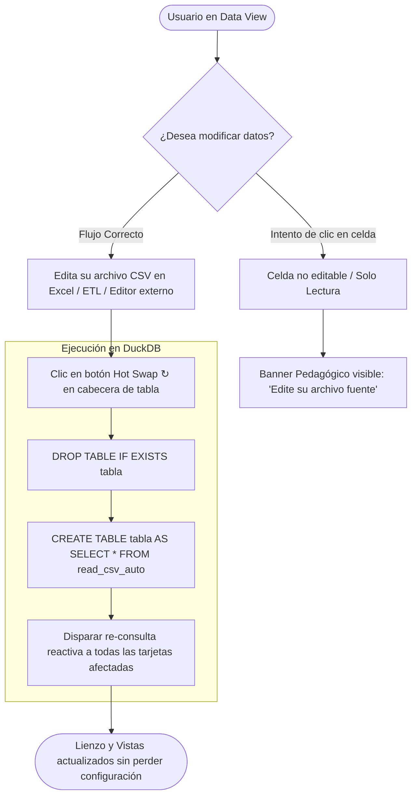
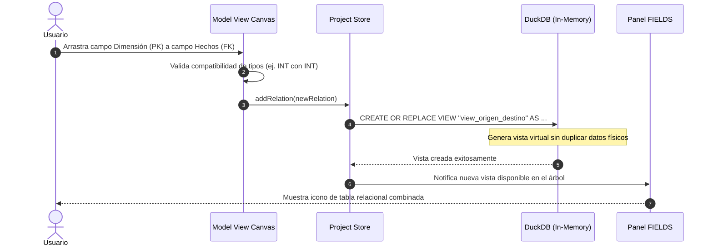

# Página 6: Arquitectura de UI y Contratos de Backend (Guía para Desarrolladores y LLMs)

> **Propósito:** Esta guía técnica define los contratos de datos, flujos de ejecución y responsabilidades entre la interfaz gráfica (inspirada en Power BI Desktop) y el backend analítico en memoria (DuckDB + Tauri/Rust). Cualquier desarrollador o modelo LLM en turno debe respetar estos patrones para no romper la integridad del proyecto.

---

## 1. Diagrama de Arquitectura Global de Ejecución

El siguiente diagrama detalla cómo los componentes visuales de la interfaz de usuario se comunican con los motores de estado y con DuckDB:

```mermaid
graph TD
    subgraph UI_Shell [Shell de Escritorio Power BI Layout]
        TitleBar[Barra de Título: Guardar / Deshacer / Proyecto]
        Ribbon[Cinta Ribbon: Inicio / Modelado / Ver / Formato]
        ViewSwitcher[Barra Lateral de Vistas: 3 Iconos]
        RightPanels[Paneles Laterales: Visuals / Fields / Filters]
        PageBar[Barra Inferior: Solapas de Páginas y Zoom]
    end

    subgraph State_Layer [Capa de Estado React / Store]
        NavState[Estado de Navegación: activeView = report | data | model]
        ProjectStore[Estado del Proyecto: charts, filters, relations, activeTheme]
        CatalogStore[Catálogo de Datos: tablas cargadas, esquemas, tipos]
    end

    subgraph Views_Canvas [Lienzo según Vista Activa]
        ReportCanvas[Report View: Cuadrícula de Gráficos ECharts y KPIs]
        DataGrid[Data View: Visor Tabular SOLO LECTURA + Paginador]
        ModelGraph[Model View: Diagrama de Nodos y Conectores de Tablas]
    end

    subgraph Engine [Motor Backend DuckDB + Tauri/Rust]
        DuckDB[(DuckDB In-Memory)]
        RustFS[Tauri IPC / File System Watcher]
        Exporter[Compilador HTML Autocontenido]
    end

    ViewSwitcher -->|Cambio de Vista| NavState
    NavState -->|Renderiza| Views_Canvas

    Ribbon -->|Acciones de Guardar / Abrir| ProjectStore
    Ribbon -->|Importar CSV / Hot Swap| RustFS
    RustFS -->|Carga de CSV| DuckDB
    DuckDB -->|Introspección table_info| CatalogStore
    CatalogStore -->|Actualiza árbol de campos| RightPanels

    RightPanels -->|Drag & Drop de Campos| ReportCanvas
    ReportCanvas -->|Ejecuta SQL con agregaciones| DuckDB
    DuckDB -->|Resultados vectorizados| ReportCanvas

    DataGrid -->|LIMIT / OFFSET paginado| DuckDB
    ModelGraph -->|CREATE VIEW / JOIN virtual| DuckDB
    TitleBar -->|Exportar| Exporter
    Exporter -->|Genera reporte estático| ReportCanvas
```

---

## 2. Contratos de la Vista de Datos (Data View - Solo Lectura)

### 2.1. Regla Inmutable de Arquitectura
La **Vista de Datos** es estrictamente de **Solo Lectura (`READ-ONLY`)**. No implementa ni implementará inputs editables, celdas mutables ni operaciones `UPDATE` / `INSERT` en DuckDB.

### 2.2. Justificación Técnica: Fuente Única de Verdad
Analyticraft opera bajo el principio de que el archivo CSV físico es la única fuente de la verdad. Modificar celdas en el visor de datos generaría:
1. Desincronización silenciosa con los sistemas fuente (ERP, CRM, contabilidad).
2. Pérdida de reproducibilidad en auditorías analíticas.
3. Riesgo de invalidar claves foráneas y relaciones en memoria (`JOINs`).

### 2.3. Diagrama de Flujo: Intento de Edición vs. Hot Swap CSV



### 2.4. Contrato de Consulta SQL para Data View
Para garantizar navegación fluida en tablas con 500k+ registros sin colapsar el DOM:
```sql
-- 1. Obtener metadatos de columnas
PRAGMA table_info('nombre_tabla');

-- 2. Conteo total para paginador
SELECT COUNT(*) AS total_rows FROM "nombre_tabla";

-- 3. Carga de ventana virtualizada (ejemplo: página 1 de 100 filas)
SELECT * FROM "nombre_tabla"
LIMIT 100 OFFSET 0;
```

---

## 3. Contratos de la Vista de Modelo (Model View - Grafo de Relaciones)

### 3.1. Estructura de Datos de una Relación (`TableRelation`)
Toda conexión creada en la `ModelView` debe almacenarse bajo la interfaz:
```typescript
export interface TableRelation {
  id: string;               // UUID único de la relación
  name: string;             // Nombre identificador (ej: 'rel_sales_stores')
  sourceTable: string;      // Tabla dimensional (Lado 1 - PK)
  sourceColumn: string;     // Columna clave en dimensión (ej: 'StoreKey')
  targetTable: string;      // Tabla de hechos (Lado * - FK)
  targetColumn: string;     // Columna clave foránea (ej: 'StoreKey')
  joinType: "LEFT" | "INNER"; // Tipo de unión relacional
  cardinality: "1:N" | "N:1" | "1:1"; // Cardinalidad visual
  description?: string;     // Explicación semántica para el usuario
}
```

### 3.2. Ciclo de Vida Backend de una Relación



### 3.3. Protocolo de Descarte Seguro (`DROP VIEW`)
Cuando el usuario presiona el botón de eliminar relación (**🗑️**):
1. Se recupera el identificador de la vista generada (`view_s_t`).
2. Se ejecuta en DuckDB: `DROP VIEW IF EXISTS "view_s_t";`.
3. Se remueve la relación del array `project.relations`.
4. Si alguna tarjeta gráfica estaba vinculada a esta vista, se le asigna un estado de advertencia indicando que la fuente fue eliminada, sin crashear la aplicación.

---

## 4. Contratos de la Cinta Ribbon y Despacho de Comandos

La Cinta de Opciones (`RibbonMenu`) no almacena lógica analítica por sí misma; actúa como una fachada de comandos mediante un despachador unificado:

| Pestaña Ribbon | Grupo de Herramientas | Acción UI | Contrato Backend / Operación |
|---|---|---|---|
| **Inicio** | Portapapeles | `Copiar Tarjeta` | Clona el objeto `ChartConfig` con nuevo `id` único y añade al store. |
| **Inicio** | Páginas | `+ Nueva Página` | Añade `{ id, name: 'Página N', charts: [] }` al proyecto activo. |
| **Inicio** | Datos y Consultas | `Obtener CSV` | Abre selector de archivo nativo (Tauri dialog / input) y corre `read_csv_auto`. |
| **Inicio** | Datos y Consultas | `Hot Swap (↻)` | Reemplaza atómicamente la tabla en DuckDB y emite evento de refresco. |
| **Inicio** | Cálculos | `Nueva Medida` | Abre modal para registrar expresión SQL analítica (`WITH measure AS ...`). |
| **Modelado** | Relaciones | `Administrar Relaciones` | Abre modal con tabla CRUD de `TableRelation` y previsualización de JOINs. |
| **Ver** | Apariencia | `Selector de Tema` | Modifica `project.activeTheme` (aplica a tarjetas, no a la interfaz). |
| **Formato** | Alineación | `Alinear Arriba / Centro` | Recalcula coordenadas `{x, y}` de las tarjetas seleccionadas en el canvas. |

---

## 5. Contratos de Drag & Drop entre Paneles y Visualizaciones

Cuando el usuario arrastra una columna desde el panel **FIELDS** hacia una zona de colocación del panel **Visualizations**:

```typescript
// Payload transferido en el evento de arrastre:
export interface DraggedFieldPayload {
  tableName: string;       // Nombre de la tabla o vista origen
  columnName: string;      // Nombre de la columna seleccionada
  dataType: "string" | "number" | "date" | "boolean"; // Tipo inferido por DuckDB
}
```

### Generación de Consulta SQL Vectorizada:
Cuando se actualiza una tarjeta en el canvas, el backend ejecuta:
```sql
SELECT
  "{dimensionCol}" AS dim,
  {aggregation}("{metricCol}") AS val
FROM "{tableName}"
{WHERE_CLAUSE}
GROUP BY "{dimensionCol}"
ORDER BY val DESC
LIMIT 50;
```
*(Donde `{WHERE_CLAUSE}` integra filtros globales, locales y segmentadores cruzados).*

---

## 6. Reglas de Oro para LLMs y Desarrolladores

Para preservar la coherencia y estabilidad del proyecto, cualquier contribución o refactorización debe cumplir sin excepción:

1. **NO alterar archivos CSV en disco:** Todo procesamiento es en memoria volátil de DuckDB.
2. **NO implementar edición de celdas en la Vista de Datos:** La Vista de Datos es estrictamente de solo lectura.
3. **NO mezclar estilos de tarjetas con la carcasa del Studio:** La interfaz de la aplicación siempre debe usar la paleta gris industrial de `src/App.css`. Los 17 temas de `themes.ts` son exclusivos de las tarjetas de gráficos.
4. **NO introducir lenguajes propietarios como DAX:** Todas las medidas y cálculos se escriben en **SQL estándar soportado nativamente por DuckDB**.
5. **Sanitización obligatoria en la exportación HTML:** Cualquier valor inyectado en el archivo `.html` autocontenido debe pasar por `escapeHtml()` y `safeJson()` para evitar vulnerabilidades XSS.

---

## 7. Registro de Ingeniería Backend: Shell Desktop y Barra Lateral de Vistas (3 Modos)

Este registro documenta las decisiones técnicas y patrones de ingeniería adoptados a partir de la implementación de la **Fase 3: Shell Desktop y Barra Lateral de Vistas**:

### 7.1. Máquina de Estados de Navegación (`AppViewMode`)
- **Definición de Tipo:** `export type AppViewMode = "report" | "data" | "model";` en `src/types/dashboard.ts`.
- **Serialización en Proyectos:** El campo opcional `activeView?: AppViewMode` se incluye en el esquema JSON `.analyticraft` para que al reabrir un proyecto el usuario regrese exactamente a la vista en la que estaba trabajando.
- **Transiciones Deterministas:** La vista se conmuta de manera unívoca mediante `setActiveView(mode)` sin routing basado en URLs de navegador, garantizando compatibilidad con el entorno empaquetado de Tauri WebView2/WebKit.

### 7.2. Ciclo de Vida Condicional y Liberación de CPU
- **Problema Detectado:** Apache ECharts mantiene escuchadores de eventos DOM, resize observers y bucles de animación que consumen ciclos de GPU y CPU innecesariamente si el lienzo no es visible.
- **Solución Backend/Frontend:**
  - El contenedor principal de informe `{activeView === "report" && (...)}` se desmonta condicionalmente cuando el usuario conmuta a `data` o `model`.
  - El hook de limpieza `dispose()` en `ChartCard.tsx` destruye las instancias activas de ECharts.
  - Al retornar a la vista de informe, las tarjetas se remontan de forma instantánea usando el `chartDataStore` en memoria sin tener que reconsultar DuckDB.

### 7.3. Despachador de Atajos Globales de Teclado
- **Mecanismo:** Un listener nativo en `window` registrado en un hook `useEffect` en `src/App.tsx`.
- **Guarda Anti-Colisión:** Se evalúa `e.target instanceof HTMLInputElement || e.target instanceof HTMLTextAreaElement || e.target instanceof HTMLSelectElement`. Si el usuario está escribiendo un título o fórmula, los atajos de cambio de vista no interceptan la escritura.
- **Tabla de Mapeo de Atajos:**
  - `Ctrl + 1` / `Cmd + 1`: Activa `report` (Vista de Informe).
  - `Ctrl + 2` / `Cmd + 2`: Activa `data` (Vista de Datos - Solo Lectura).
  - `Ctrl + 3` / `Cmd + 3`: Activa `model` (Vista de Modelo Relacional).
  - `Ctrl + S` / `Cmd + S`: Invoca `handleSaveProject()` para exportar `.analyticraft`.
  - `Ctrl + Z` / `Cmd + Z`: Deshace la última mutación en el lienzo restaurando snapshot del historial.
  - `Ctrl + Y` / `Cmd + Y`: Rehace la acción previamente deshecha.

### 7.4. Pipeline de Consulta Reactiva en Data View
- Cuando `activeView === "data"`, un efecto reactivo detecta la tabla seleccionada en `dataViewTable` (o por defecto la primera tabla del catálogo `tables[0]?.name`).
- Ejecuta de forma asíncrona:
  ```typescript
  executeQuery(`SELECT * FROM "${target}" LIMIT 100`)
  ```
- Almacena el resultado en `dataViewRows` y previene re-ejecuciones redundantes salvo que cambie `refreshVersion` (disparado tras un Hot Swap o refresco manual).

### 7.5. Pila de Historial y Deshacer/Rehacer en Memoria
- Se mantiene un buffer de estados previos `history: { charts: ChartConfig[]; filters: GlobalFilter[] }[]` limitado a un máximo de 25 snapshots (`slice(-25)`).
- Cada acción significativa (agregar tarjeta, eliminar filtro, aplicar filtro global) invoca `recordSnapshot()`, vaciando la pila `future`.
- `handleUndo()` y `handleRedo()` intercambian snapshots de forma atómica actualizando tanto `charts` como `globalFilters`, manteniendo feedback visual mediante notificaciones flotantes toast.

### 7.6. Bitácora de Refactorización de UI/UX, Principios Gestalt y Desacoplamiento de Modales
En preparación para la Fase 4, se definieron las siguientes directrices y contratos para resolver fricciones de ergonomía y enrutamiento en el shell:

1. **Racionalización de la Quick Access Toolbar (TitleBar):**
   - *Decisión:* Las operaciones a nivel de archivo/documento (`Guardar`, `Abrir`, `Deshacer`, `Rehacer`) pertenecen al ciclo de vida del proyecto (`.analyticraft`) y deben agruparse en la barra superior izquierda exclusivamente mediante iconos de contorno (`FolderOpen`, `Save`, `Undo2`, `Redo2`).
   - *Eliminación de Redundancia:* Se eliminan los botones duplicados de texto (`[ Abrir ]` y `[ Guardar ]`) en la barra superior derecha, reduciendo la carga cognitiva y despejando el espacio central para la pastilla del proyecto.

2. **Jerarquía Visual y Principio de Gestalt en la Sub-Barra de Herramientas:**
   - La sub-barra actúa como la cinta operativa primaria del analista. Para evitar el desorden visual, se aplica la ley de proximidad y semejanza de Gestalt:
     - **Bloque Izquierdo (Mutación y Modelado):** `[ + Agregar Gráfico ]`, `[ Modelador Relacional (JOIN) ]`, `[ Refrescar Consultas ]`. Operaciones que interactúan con el motor analítico DuckDB y la disposición del lienzo.
     - **Bloque Derecho (Configuración, Ayuda y Salida):** `[ Selector de Tema ]`, `[ Wiki ]`, `[ Guía Exportar CSV ]`, `[ Exportar .HTML ]`.
   - **Atenuación del Botón Exportar:** En herramientas de BI de escritorio, la exportación es una acción terminal, no el foco de atención continuo. Un botón verde saturado distorsiona la jerarquía visual del workbench. Se sustituye por un estilo secundario profesional (`#252526` con borde sutil y acento verde).
   - **Eliminación de Texto Redundante del Tema:** El tema activo ya se refleja en la pastilla del botón selector; mostrar un label de texto adicional al lado consumía espacio sin aportar valor.

3. **Desacoplamiento de Enrutamiento y Ciclo de Vida de Modales (Bug Fix):**
   - *Diagnóstico del Bug:* El botón `Guía Exportar CSV` en la sub-barra invocaba `setActiveWikiPage(5); setShowWikiModal(true);`. Esto generaba una colisión de estado: si el usuario consultaba la guía CSV y posteriormente pulsaba el botón `Wiki`, el modal se abría anclado en la página 5 en lugar del índice general o de la última página leída.
   - *Contrato Técnico:* Separar los estados de visualización. La guía de exportación CSV dispondrá de su propio estado o modal desacoplado (`showCsvGuideModal`), asegurando que la navegación en la documentación general de la Wiki permanezca independiente y sin efectos colaterales.

4. **Consistencia Iconográfica y Optimización de Ergonomía Vertical:**
   - Toda la interfaz adopta una estética uniforme de línea (`strokeWidth={1.5}` de Lucide), evitando inconsistencias entre iconos sólidos y de contorno.
   - Para maximizar los píxeles útiles en el eje Y (crucial para visualizar múltiples filas y gráficos sin scroll vertical asfixiante), se proyecta la migración de la barra horizontal de filtros hacia un panel lateral derecho colapsable (estilo *Filters Pane* de Power BI Desktop).
