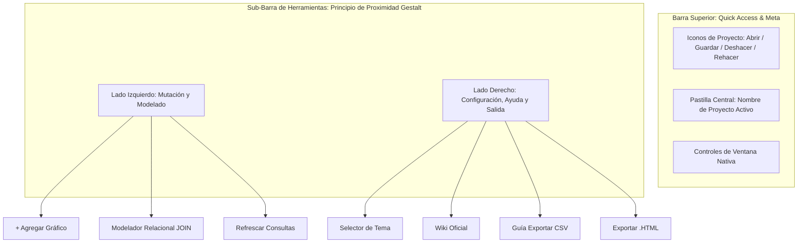
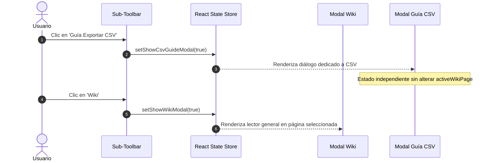

# Página 7: Ergonomía de UI, Principios de Gestalt y Arquitectura de Diálogos

> **Propósito:** Esta guía técnica documenta las decisiones de diseño de interfaz (UI), ergonomía cognitiva y arquitectura de modales/diálogos adoptadas en la Fase 4 de Analyticraft Studio para optimizar el flujo de trabajo del analista de BI y eliminar fricciones de usabilidad.

---

## 1. Principios de Gestalt Aplicados al Shell de BI

Analyticraft aplica los principios de la psicología de la Gestalt para que la interfaz se interprete de forma instantánea, intuitiva y sin sobrecarga cognitiva:



### 1.1. Ley de Proximidad y Agrupación Semántica
- **Acciones de Modelo y Datos (Lado Izquierdo):** Agrupa las operaciones que alteran el lienzo analítico (`+ Agregar Gráfico`), crean uniones lógicas (`Modelador Relacional`) o fuerzan re-cálculos SQL en DuckDB (`Refrescar Consultas`).
- **Acciones de Soporte y Salida (Lado Derecho):** Agrupa las operaciones de estilo (`Selector de Tema`), documentación interactiva (`Wiki` y `Guía CSV`) y la exportación final (`Exportar .HTML`).

### 1.2. Atenuación Visual del Botón de Exportación (Jerarquía y Contraste)
En herramientas profesionales de Business Intelligence, la interacción continua ocurre en el lienzo (exploración, filtrado, creación de visuales). 
- **Problema previo:** El botón `Exportar .HTML` con verde saturado brillante atraía desproporcionadamente la atención visual del usuario, rompiendo la calma de la paleta gris workbench industrial (`#1e1e1e` a `#252526`).
- **Solución:** Se transformó en un botón secundario discreto con fondo oscuro (`#1c2b20`), borde verde sutil (`#2e7d32`) y texto `#81c784`. Mantiene su identidad semántica de salida sin competir con los datos visualizados.

### 1.3. Eliminación de Duplicidades y Redundancias
- **Quick Access Toolbar Unificada:** Los botones `Abrir` y `Guardar` con texto en la barra superior se eliminaron. Ahora residen como iconos de trazo fino (`FolderOpen`, `Save`) junto a `Deshacer` y `Rehacer` en la esquina superior izquierda, siguiendo la convención de Power BI Desktop.
- **Supresión de Label de Tema:** Se eliminó la etiqueta `"Tema Gráficos: [Nombre]"`. El nombre de la paleta activa vive únicamente dentro del botón del selector de temas.

---

## 2. Arquitectura de Diálogos y Resolución de Enrutamiento (Bug Fix)

### 2.1. Diagnóstico del Conflicto de Enrutamiento
Con anterioridad, el botón `Guía Exportar CSV` de la sub-barra reciclaba el modal general de la Wiki mediante:
```typescript
// Antipatrón acoplado (generaba bug de colisión):
setActiveWikiPage(5);
setShowWikiModal(true);
```
**Efecto no deseado:** Si el usuario consultaba la guía técnica de exportación CSV y luego deseaba explorar la documentación general de Analyticraft pulsando el botón `Wiki`, el lector quedaba bloqueado en la página 5, perdiendo el índice y el contexto de lectura.

### 2.2. Desacoplamiento de Contratos de Diálogo
Se independizaron los canales de diálogo en estados atómicos:
- `showWikiModal: boolean`: Controla el lector de documentación del sistema (visión, arquitectura, contratos).
- `showCsvGuideModal: boolean`: Controla el diálogo modal focalizado exclusivamente en la preparación y exportación de archivos CSV limpios desde Excel, Google Sheets, Numbers y motores SQL.



---

## 3. Paginación e Introspección en Vista de Datos (Data View)

Para satisfacer el contrato de rendimiento (<16 ms de latencia) en tablas con cientos de miles de registros:

### 3.1. Consultas Paralelas DuckDB
Cuando se activa la Vista de Datos (`activeView === "data"`), se disparan en paralelo dos operaciones asíncronas:
```sql
-- 1. Introspección de volumen total
SELECT COUNT(*) AS total FROM "nombre_tabla";

-- 2. Ventana de datos paginada (offset dinámico)
SELECT * FROM "nombre_tabla"
LIMIT 100 OFFSET ?;
```

### 3.2. Controles de Paginación en UI
- Barra de estado inferior con indicador: `Mostrando N - M de TOTAL registros`.
- Botones de navegación `◀ Anterior` y `Siguiente ▶` desactivados condicionalmente en los límites de la tabla.
- Cambio atómico de página que preserva la inmutabilidad de la memoria y nunca permite edición directa sobre celdas.
