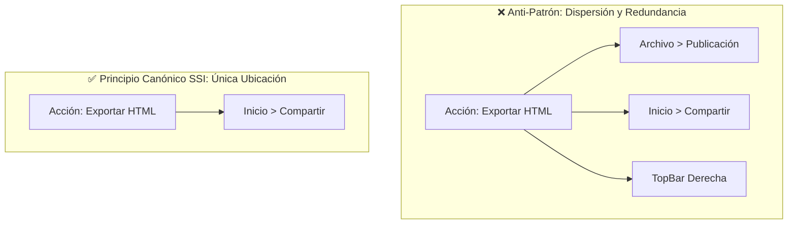

# 🛡️ Página 9: Guía Anti-Duplicidad y Principio de Responsabilidad Única en UI (Directiva para Desarrolladores y LLMs)

> [!IMPORTANT]
> **DIRECTIVA OBLIGATORIA PARA AGENTES LLM Y DESARROLLADORES:**
> Queda estrictamente prohibido duplicar botones, comandos o accesos directos a lo largo de las distintas pestañas del Ribbon, barras laterales o cabeceras del sistema. Cada capacidad del software debe tener **una única ubicación canónica primaria**. La presencia de múltiples botones que ejecutan la misma acción genera una ilusión destructiva de complejidad, confunde al analista y destruye la ergonomía del producto.

---

## 1. La Patología del "Relleno Inconsciente" (The Unconscious Padding Anti-Pattern)

Al desarrollar interfaces densas estilo Microsoft Power BI Desktop, los Modelos de Lenguaje (LLMs) y programadores noveles tienden a incurrir de forma repetitiva en un sesgo cognitivo: **el miedo al espacio vacío en las pestañas**.

Cuando una pestaña (ej. `Archivo`, `Modelado` o `Ver`) contiene únicamente uno o dos comandos implementados, el generador tiende a "rellenar" visualmente la cinta importando botones de otras secciones:
- Duplica `Exportar HTML` tanto en `Archivo` como en `Inicio`.
- Duplica `Relaciones JOIN` tanto en `Inicio` como en `Modelado` y en el `Left View Rail`.
- Reitera los botones de navegación `Informe`, `Datos` y `Modelo` dentro de la pestaña `Ver`, estando ya anclados permanentemente a solo 40 píxeles de distancia en el riel lateral izquierdo.
- Agrega controles de ventana simulados (`─`, `□`, `✕`) o botones de ayuda repetidos en la barra superior.

### Consecuencias Técnicas y Cognitivas de la Duplicidad:
1. **Sobrecarga Cognitiva (Ley de Hick):** El usuario tarda más en decidir qué botón presionar porque el sistema le ofrece 3 puertas distintas hacia el mismo pasillo.
2. **Deuda Técnica de Sincronización:** Cada réplica visual de un botón requiere mantener estados deshabilitados (`disabled`), tooltips, listeners de atajos y suscripciones reactivas en paralelo. Si un botón se actualiza y su réplica no, se introduce un bug inmediato en la UI.
3. **Falsa Sensación de Complejidad ("Software Hinchado"):** Un aplicativo que implementa 8 acciones reales aparenta tener 30 botones, lo que intimida al usuario y reduce la confianza en la madurez arquitectónica del sistema.

---

## 2. El Principio de Responsabilidad Única en UI (Single Source of Interaction - SSI)

Toda interacción de usuario en Analyticraft debe adherirse al principio **SSI (Single Source of Interaction)**:

### Reglas Rectoras de Asignación:
1. **Regla de Prohibición de Duplicidad Vertical:** Si un comando ya reside en una barra persistente (como la `TitleBar` superior con *Guardar*, o el `Left View Rail` con los 3 modos de vista), **no se puede repetir** en ninguna pestaña del Ribbon.
2. **Regla de Pertenencia Semántica:** Cada comando pertenece a la pestaña cuyo verbo o sustantivo describe de manera unívoca su función principal:
   - Modificación de layout/color -> `Diseño` (dentro de `Inicio` para acceso ultrarrápido).
   - Inserción de nuevos elementos analíticos -> `Insertar`.
   - Inspección y esquema tabular/relacional -> `Modelado`.
   - Soporte y visualización contextual de ayuda -> `Ver`.
3. **Aceptación del Espacio Compacto:** Una pestaña con un solo grupo de 2 botones elegantes y bien espaciados es infinitamente superior a una pestaña abarrotada de botones clones.

---

## 3. La "Prueba del Espejo de Comandos" (Command Mirroring Test)

**Antes de agregar cualquier botón o componente interactivo al Ribbon o al Shell, todo LLM o desarrollador debe someter el cambio a esta lista de verificación booleana:**

| Pregunta de Control | Si la respuesta es SÍ: |
| :--- | :--- |
| ¿Este botón invoca una acción (`type: ...`) que ya existe en otra pestaña o barra visible? | ⛔ **RECHAZAR.** No agregues el botón. Si es un comando de uso universal, evalúa si su ubicación actual es la óptima. |
| ¿El botón está a menos de 250px de otro botón con el mismo propósito en pantalla? | ⛔ **RECHAZAR.** Viola el principio de Gestalt de proximidad y satura la densidad visual. |
| ¿Se está introduciendo un control visual simulado (ej. botones de minimizar/cerrar ventana en una app web o inputs que no persisten)? | ⛔ **RECHAZAR.** Si un elemento no tiene funcionalidad nativa real, debe ser un texto legible o eliminarse por completo. |
| ¿Se está agregando el botón simplemente para que el grupo o la pestaña "no se vea vacía"? | ⛔ **RECHAZAR.** La simplicidad y el minimalismo profesional son virtudes de diseño, no defectos. |
| ¿El botón representa una acción reservada para una fase futura aún no codificada? | ⛔ **RECHAZAR.** No agregues botones muertos o mocks que no hagan nada. Codifica la funcionalidad en su fase correspondiente del Roadmap. |

---

## 4. Matriz Maestra de Ubicaciones Canónicas (Mapa Oficial)

Para evitar dudas o divergencias, esta matriz establece la **única ubicación permitida** para cada acción en Analyticraft:

| Acción del Sistema | Tipo de Despacho | Ubicación Canónica Única | Ubicaciones Prohibidas (Anti-Patrones) |
| :--- | :--- | :--- | :--- |
| **Nuevo Proyecto** | `NEW_PROJECT` | `Archivo > Proyecto` | Prohibido en `Inicio`, `Insertar` o `TopBar`. |
| **Abrir Proyecto** | `OPEN_PROJECT` | `TopBar (Quick Access)` y `Archivo > Proyecto` | Prohibido en `Inicio` o `Modelado`. |
| **Guardar Proyecto** | `SAVE_PROJECT` | `TopBar (Quick Access)` y `Archivo > Proyecto` | Prohibido en `Inicio` o `Modelado`. |
| **Deshacer / Rehacer** | `UNDO` / `REDO` | `TopBar (Quick Access)` (`Ctrl+Z` / `Ctrl+Y`) | Prohibido en el Ribbon. |
| **Portapapeles (Copiar/Pegar/Duplicar/Eliminar)** | `COPY_CARD`, `PASTE_CARD`, etc. | `Inicio > Portapapeles` y `Formato > Operaciones` | Prohibido en `Insertar`, `Archivo` o menús externos. |
| **Obtener CSV / Ingesta** | Evento `handleFileUpload` | `Inicio > Datos > Obtener CSV` | Prohibido en `Archivo` o `Insertar`. |
| **Hot Swap de Tabla Activa** | `TRIGGER_HOT_SWAP` | `Inicio > Datos` y cabecera de `Vista de Datos` | Prohibido en `Modelado` o `Archivo`. |
| **Actualizar Todo** | `REFRESH_ALL_DATA` | `Inicio > Datos > Actualizar Todo` | Prohibido en `Ver` o `Modelado`. |
| **Selector de Tema de Tarjetas (17 Paletas)** | `SET_THEME` | `Inicio > Diseño` (Popover Flotante `z-index: 9999`) | Prohibido en `Ver` o `Formato`. |
| **Exportar HTML Interactivo** | `EXPORT_HTML` | `Inicio > Compartir > Exportar HTML` | Prohibido en `Archivo` o `TopBar`. |
| **Insertar Gráficos (6 Tipos)** | `ADD_CHART` con tipo | `Insertar > Visualizaciones` | Prohibido duplicar en `Inicio`. |
| **Insertar Filtro Global** | `handleAddGlobalFilter` | `Insertar > Controles y Filtros` | Prohibido duplicar en `Inicio` o barras fijas. |
| **Navegación de Vistas (Informe, Datos, Modelo)** | `SWITCH_VIEW` | `Left View Switcher Rail` (extremo izquierdo) | **Estrictamente prohibido en `Ver` o en `Modelado`.** |
| **Glosario y Ayuda en Pantalla** | `TOGGLE_QUICK_HELP` | `Ver > Soporte > Glosario en Pantalla` | Prohibido en `Archivo` o `Inicio`. |
| **Wiki Oficial y Guía CSV** | `OPEN_WIKI` / `OPEN_CSV_GUIDE` | `Archivo > Documentación` | Prohibido en `Inicio` o `Ver`. |
| **Formato Contextual de Tarjeta** | Modificadores de tarjeta | `Pestaña Contextual Formato` (activa con tarjeta) | Prohibido en pestañas fijas (`Inicio`, `Ver`). |

---

## 5. Estudio de Caso: El Refactor de Deduplicación y Estabilidad (v0.5.1)

Durante el ciclo de desarrollo de la Fase 5, se detectaron y corrigieron 10 anomalías críticas de duplicidad y comportamiento:

1. **Eliminación de Controles Mock de Ventana:**
   - *Problema:* La barra superior renderizaba botones simulados `─`, `□`, `✕` y un botón `?` que no controlaban el sistema operativo nativo ni aportaban valor.
   - *Solución:* Fueron removidos por completo, delegando la gestión de ventana al marco nativo de Tauri / SO.
2. **Sustitución de Input por Label de Proyecto:**
   - *Problema:* El nombre del proyecto se renderizaba como un campo `<input>` editable que no persistía renombrados de archivos en disco.
   - *Solución:* Se reemplazó por un `` de solo lectura y alta legibilidad.
3. **Depuración de la Pestaña `Archivo`:**
   - *Problema:* Existía un grupo `Publicación` con un botón `Exportar HTML` duplicando el comando de `Inicio`.
   - *Solución:* Se suprimió el grupo `Publicación` y se renombró `Guía CSV` a `¿Cómo traer tus datos?` bajo `Documentación`.
4. **Desmantelamiento de Redundancias en `Inicio`:**
   - *Problema:* `Inicio` acumulaba grupos de `Visuales Rápidos` (duplicado de `Insertar`) y `Relaciones JOIN` (duplicado de `Modelado`).
   - *Solución:* Se retiraron ambos grupos, manteniendo en `Inicio` únicamente: `Portapapeles`, `Datos`, `Diseño` (Temas) y `Compartir`.
5. **Liberación de Espacio Vertical (Filtros Globales Condicionales):**
   - *Problema:* Una barra fija `.filter-bar` consumía 40px de altura vertical permanente entre la cinta y el canvas incluso cuando no existía ningún filtro activo.
   - *Solución:* La barra ahora se renderiza de forma reactiva y condicional únicamente si `globalFilters.length > 0`.
6. **Depuración de `Modelado`:**
   - *Problema:* La pestaña incluía un botón de `Crear JOIN` que duplicaba el modelador visual interactivo.
   - *Solución:* Se conservaron exclusivamente accesos directos de navegación técnica (`Vista Modelo` y `Vista Datos`).
7. **Depuración de `Ver`:**
   - *Problema:* Incluía botones para alternar vistas (`Informe`, `Datos`, `Modelo`) que estaban a solo 40px del riel lateral.
   - *Solución:* Se removió el grupo `Vistas del Sistema`, conservando en `Ver` el soporte informativo (`Glosario en Pantalla`).
8. **Solución al Conflicto de Z-Index del Selector de Temas:**
   - *Problema:* El catálogo de temas quedaba recortado por el contenedor del Ribbon (`overflow-y: hidden`) o se renderizaba por detrás del canvas.
   - *Solución:* Se asignó `overflow: visible; position: relative; z-index: 100;` al Ribbon y `z-index: 9999;` al menú flotante con sombra volumétrica y renderizado nítido.
9. **Empty State UI Humanizada para Errores DuckDB:**
   - *Problema:* Errores de tipo SQL (`Binder Error: Cannot compute sum(VARCHAR)`) rompían la tarjeta o mostraban un stacktrace crudo de base de datos incomprensible para un analista novato.
   - *Solución:* Se implementó un estado vacío pedagógico que detecta el error de tipo, explica que las funciones cuantitativas (`SUM`, `AVG`) requieren datos numéricos y guía al usuario paso a paso para corregir el Eje X o Eje Y.
10. **Corrección Reactiva del Pie de Tarjeta:**
    - *Problema:* El botón `Pie: Oculto/Visible` alternaba el estado en el Ribbon pero la tarjeta `ChartCard.tsx` no evaluaba el booleano `showDescription`.
    - *Solución:* Se vinculó la propiedad reactiva `config.showDescription !== false` en el renderizado de la tarjeta y se inicializó con `true` por defecto.

---

## 6. Mandato de Preservación para Futuras Fases (Fases 6 a 18)

Al implementar los paneles acoplables de **Visualizaciones y Campos (Fase 6)**, el **Lienzo de Grafo Relacional (Fase 7)** o el **Lienzo Libre Magnético (Fase 9)**:
- **NO** crees botones en el Ribbon para funcionalidades que pertenecen intrínsecamente a paneles laterales desplegables (como la selección de campos o formato por tarjeta).
- **NO** dupliques la galería de gráficos: la galería vive en `Insertar > Visualizaciones` y en la cabecera del panel lateral derecho de visuales.
- **SIEMPRE** consulta esta página y la [Página 6 (Contratos)](./Página%206%20Arquitectura%20de%20UI%20y%20Contratos%20de%20Backend%20(Guía%20para%20Desarrolladores%20y%20LLMs).md) antes de proponer una modificación en el árbol de navegación o cinta de opciones.
