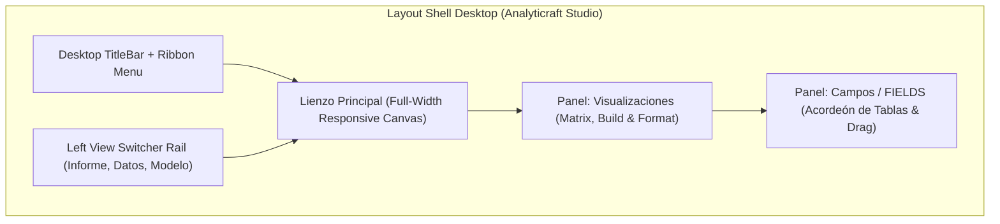

# 📊 Página 10: Paneles Laterales de Visualizaciones y Campos (Drag & Drop y Constructor SQL Reactivo)

Bienvenido a la documentación técnica de los **Paneles Laterales Acoplables a la Derecha** y el motor de **Drag & Drop Tipado** de **Analyticraft**, implementados en la **Fase 6 del Roadmap**. Esta arquitectura traslada el núcleo interactivo de Power BI Desktop al entorno de escritorio ligero (Tauri + React + DuckDB), permitiendo al analista componer consultas vectorizadas complejas simplemente arrastrando columnas hacia zonas de colocación visuales.

---

## 1. Visión y Ergonomía de los Paneles Laterales

En herramientas estándar como Microsoft Power BI Desktop, el lienzo principal de trabajo se sitúa entre el riel de navegación de vistas a la izquierda y los paneles operativos a la derecha.



### Principios de Diseño:
1. **Lienzo Despejado y Expansivo:** Se eliminó la antigua barra fija de fuentes del lado izquierdo, permitiendo que el lienzo comience inmediatamente junto al riel de 3 vistas y aproveche todo el ancho útil del monitor.
2. **Acoplabilidad Independiente:** Tanto el panel de **Visualizaciones** (250px) como el de **Campos** (260px) cuentan con pestañas de riel colapsable en el borde derecho (`.docked-rail-tab`). El usuario puede plegar uno o ambos paneles con un solo clic para ganar el 100% del ancho del lienzo.
3. **Persistencia y Reactividad:** Las acciones realizadas en los paneles (cambio de tipo de visual, soltado de columnas o modificación de títulos) mutan el store central de React en tiempo real e invocan consultas SQL sub-milisegundo en DuckDB.

---

## 2. Panel "Campos" (FIELDS / Datos)

El panel de campos representa el catálogo analítico activo disponible en la sesión de DuckDB.

### 2.1. Anatomía del Componente (`FieldsPanel.tsx`)
- **Cabecera Operativa:** Muestra el contador total de tablas (`X tablas`), botón conmutador global de **Expandir/Colapsar Todo (`ChevronsUpDown`)** para minimizar o desplegar todas las tablas del catálogo en un clic, y botón de repliegue del panel completo.
- **Buscador en Vivo (`.fields-search-box`):** Filtro de texto instantáneo con botón de limpieza (`✕`). Permite localizar columnas y métricas rápidamente entre decenas de tablas cargadas.
- **Acordeón Jerárquico por Tabla:**
  - Chevron interactivo para colapsar/expandir (`ChevronDown` / `ChevronRight`).
  - Icono distintivo (`Layers` / `Table`).
  - Nombre de la tabla física o vista relacional (`CREATE VIEW`).
  - Pastilla con el conteo real de registros (`X,XXX filas`).
  - Botón directo de **Hot Swap (↻)**: Permite sustituir el CSV de la tabla en caliente sin perder los gráficos construidos.
- **Clasificación Cromática e Iconográfica de Columnas:**
  Cada columna se clasifica según el tipo de dato inferido por DuckDB:
  - `#` **Numérico (`number` - verde/cian):** Campos cuantificables aptos para métricas y agregaciones (`SUM`, `AVG`, `MIN`, `MAX`).
  - `Abc` **Texto (`string` - azul):** Campos categóricos aptos para dimensiones y agrupaciones (`GROUP BY`).
  - `📅` **Temporal (`date` - amarillo/ámbar):** Fechas y marcas temporales para análisis de tendencias cronológicas.
  - `☑` **Booleano (`boolean` - púrpura):** Banderas binarias de verdadero/falso.

---

## 3. Contrato de la API de Arrastre Tipada (`DraggedFieldPayload`)

Para garantizar que el motor de datos reciba exactamente los metadatos necesarios al soltar un elemento en cualquier punto del sistema, se estandarizó la interfaz:

```typescript
export interface DraggedFieldPayload {
  tableName: string;                                  // Tabla o vista origen en DuckDB
  columnName: string;                                 // Nombre físico de la columna
  dataType: "string" | "number" | "date" | "boolean"; // Tipo de dato inferido
}
```

### 3.1. Flujo del Evento Drag & Drop Nativo (HTML5)
1. **Inicio de Arrastre (`onDragStart`):**
   ```typescript
   e.dataTransfer.setData("application/json", JSON.stringify(payload));
   e.dataTransfer.setData("text/plain", col.name);
   e.dataTransfer.effectAllowed = "copy";
   ```
2. **Zonas Receptoras Habilitadas:**
   - **Drop-Zones del Panel Visualizaciones (`Build`):** Asigna el campo al Eje X, Eje Y o Filtro local.
   - **Tarjetas Visuales en el Lienzo (`ChartCard.tsx`):** Soltar una columna directamente sobre una tarjeta existente resalta el borde con resplandor neón (`.drag-target-active`) y actualiza el eje correspondiente sin necesidad de abrir paneles.
   - **Lienzo Vacío (`canvas-area`):** Soltar una columna en el lienzo en blanco crea de forma autónoma una nueva tarjeta visual adaptada al tipo de dato (KPI para números, Barras para textos/fechas).

---

## 4. Panel "Visualizaciones" (`VisualizationsPanel.tsx`)

El panel de visualizaciones se compone de tres niveles funcionales:

### 4.1. Matriz de Tipos de Visual
Cuadrícula de botones con micro-iconos de contorno:
- `Barras` (`bar`): Gráfico de barras horizontales o verticales para comparación categórica.
- `Líneas` (`line`): Tendencias continuas y series cronológicas.
- `Circular / Donut` (`pie`): Composición porcentual de partes de un todo.
- `Área` (`area`): Volúmenes acumulativos.
- `KPI` (`kpi`): Tarjeta numérica destacada de un solo valor agregado.
- `Tabla` (`table`): Cuadrícula paginada de registros SQL.
- `Anillos` (`rings`): Anillos concéntricos de actividad estilo Apple Fitness.
- `Segmentador` (`slicer`): Objeto interactivo en lienzo tipo Power BI para filtrar dinámicamente todo el dashboard con un clic sobre valores de una dimensión.

> **Comportamiento:** Si hay una tarjeta seleccionada, un clic en cualquier icono transforma su tipo de gráfico conservando las columnas ya asociadas. Si no hay tarjeta seleccionada, crea instantáneamente un nuevo visual del tipo presionado.

### 4.2. Subpestaña `Construir` (`Build Visual`)
Gestiona la estructura semántica de datos de la tarjeta mediante zonas de colocación interactivas (`.dropzone-slot`):
- **Eje X (Categoría / Dimensión):**
  - Admite arrastrar columnas categóricas o temporales.
  - Pastilla interactiva con botón de transferencia rápida (`→ Y`) y arrastre directo hacia otras zonas.
  - Selector desplegable secundario de respaldo accesible.
- **Botón "Invertir Ejes (X ⇄ Y)":**
  - Ubicado entre el Eje X y Eje Y.
  - Intercambia instantáneamente los campos de ambos ejes y ajusta inteligentemente la función agregada (`COUNT` si la nueva métrica es texto, `SUM` si es numérica).
- **Eje Y (Métrica / Valores):**
  - Admite arrastrar columnas numéricas.
  - Pastilla interactiva con botón de transferencia rápida (`← X`) y arrastre directo.
  - Selector compacto de función agregada: `SUM`, `AVG`, `COUNT`, `MAX` y `MIN`.
- **Filtros en este Objeto Visual (Múltiples Filtros Locales):**
  - **Drop-Zone Multi-Filtro:** Permite soltar una o más columnas para filtrar exclusivamente este visual sin alterar el resto del lienzo.
  - **Selector Rápido de Columnas:** Permite incorporar filtros adicionales mediante lista desplegable.
  - **Conmutador On/Off por Filtro:** Cada filtro cuenta con un checkbox para pausar o reactivar su efecto en la consulta sin perder el valor configurado.
  - **Introspección Reactiva de Datos (`SELECT DISTINCT`):** DuckDB consulta en tiempo real los valores reales presentes en la columna (`LIMIT 25`) y los presenta como chips interactivos clicables.
  - **Operadores de Comparación:** `=`, `!=`, `contiene` (LIKE), `>`, `<`.
  - **Gestión Rápida:** Botón de eliminación individual (`✕`), botón de limpieza total (`🧹 Borrar todo`) y botón para pausar/reactivar todos los filtros en bloque.

### 4.3. Subpestaña `Formato` (`Format Visual`)
Centraliza las propiedades estéticas y de legibilidad:
- **Título del Visual:** Campo de texto con actualización reactiva bidireccional.
- **Interruptor de Leyenda Superior:** Conmutador On/Off (`showLegend`) para activar/ocultar leyendas en gráficos circulares y de líneas.
- **Interruptor de Nota Técnica al Pie:** Conmutador On/Off (`showDescription`) para desplegar notas pedagógicas sobre la métrica.
- **Editor de Nota al Pie:** Textarea para redactar aclaraciones metodológicas (ej. *"Cálculo neto después de devoluciones e impuestos"*).

---

## 5. El Constructor SQL Reactivo en DuckDB

Cada vez que una drop-zone recibe un campo, se invierten los ejes, o se activa/modifica un filtro local, el backend reactivo ensambla la consulta SQL vectorizada en `src/components/ChartCard.tsx`:

```sql
SELECT
  CAST("{dimensionCol}" AS VARCHAR) AS dimension,
  {aggregation}("{metricCol}") AS metric
FROM "{tableName}"
WHERE {CONDICIONES_GLOBALES} AND {CONDICIONES_LOCALES_ACTIVAS}
GROUP BY "{dimensionCol}"
ORDER BY metric DESC
LIMIT 50;
```

### Para el Visual "Segmentador de Datos" (Slicer):
```sql
SELECT
  CAST("{dimensionCol}" AS VARCHAR) AS dimension,
  COUNT(*) AS metric
FROM "{tableName}"
WHERE {CONDICIONES_GLOBALES_RESTANTES}
GROUP BY "{dimensionCol}"
ORDER BY metric DESC
LIMIT 50;
```

### Beneficios del Enfoque Vectorizado:
- **Cero Lag:** Las consultas agrupadas sobre datasets de 500k+ filas se completan en DuckDB-Wasm en menos de 16 milisegundos.
- **Seguridad contra Inyección:** Todos los identificadores de tablas y columnas se encierran entre comillas dobles sanitizadas (`"${col.replace(/"/g, '""')}"`) y literales con comillas simples escapadas (`'${val.replace(/'/g, "''")}'`).
- **Resiliencia ante Tipos:** Si el usuario intenta forzar `SUM` sobre una columna de texto, el motor Empty State humanizado (Fase 5.1) intercepta el error y guía al usuario sin romper la interfaz.
- **Indicador Visual en Tarjeta:** Las tarjetas con filtros locales activos despliegan un badge `[ 🔍 X filtro(s) ]` en su cabecera con tooltip explicativo.

---

## 6. Reglas de Preservación para Desarrolladores y LLMs

1. **NO regresar al layout con barra izquierda de tablas:** La barra lateral de tablas en el lado izquierdo queda permanentemente sustituida por el panel **Campos (FIELDS)** a la derecha. El riel izquierdo pertenece exclusivamente al conmutador de 3 vistas (`view-switcher-rail`).
2. **Preservar el Payload Tipado:** No emitas eventos de arrastre con strings planos; utiliza siempre el objeto serializado `DraggedFieldPayload` con `JSON.stringify()`.
3. **Mantener los Selectores Alternativos y Botones de Inversión:** Aunque el Drag & Drop es la interacción preferida, las drop-zones siempre deben incluir el botón de intercambio `X ⇄ Y` y selectores accesibles.
4. **Respetar la Lista Múltiple de Filtros Locales:** Toda nueva propiedad de filtrado local debe agregarse a `localFilters: LocalFilter[]` y reflejarse reactivamente en la cláusula `WHERE` de DuckDB.
5. **Sincronización con Ribbon Formato:** Los cambios de formato ejecutados en el panel derecho deben sincronizarse bidireccionalmente con la pestaña contextual `Formato` del Ribbon superior.
