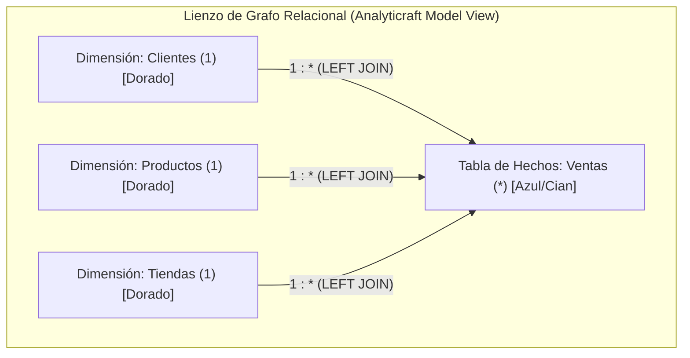

# 🕸️ Página 11: Vista de Modelo Relacional (Grafo de Tablas, Drag & Drop y Vistas Virtuales)

Bienvenido a la documentación técnica de la **Vista de Modelo Relacional (Model View)** implementada en la **Fase 7 del Roadmap** de **Analyticraft**. Esta vista traslada la experiencia de modelado relacional visual de Microsoft Power BI Desktop a un entorno de escritorio ligero y ultra-rápido impulsado por **Tauri**, **React** y **DuckDB-Wasm**.

---

## 1. Visión y Propósito de la Vista de Modelo

En lugar de forzar al analista a trabajar con un archivo CSV plano gigante y desnormalizado, Analyticraft permite importar múltiples tablas independientes (ej. `ventas`, `clientes`, `productos`, `tiendas`) y enlazarlas lógicamente en esquemas analíticos de **Estrella (Star Schema)** o **Copo de Nieve (Snowflake Schema)**.



### Beneficios Clave:
1. **Normalización sin Dolor:** Mantiene los CSVs físicos livianos y libres de datos duplicados.
2. **Cero Mutación en Disco:** Las relaciones no alteran ni reescriben los archivos CSV originales; se instancian como **Vistas Virtuales SQL (`CREATE VIEW`)** en la memoria vectorizada de DuckDB.
3. **Modelado Visual Intuitivo:** La creación de relaciones se realiza simplemente arrastrando una columna de una tabla y soltándola sobre la columna equivalente de otra.

---

## 2. Anatomía de la Interfaz (`ModelView.tsx`)

Al presionar el tercer botón del riel izquierdo de vistas (`Ctrl+3`), se accede al diseñador relacional compuesto por:

### 2.1. Barra de Herramientas Superior (`.model-toolbar`)
- **Identificador y Contadores:** Muestra el total de tablas cargadas y relaciones activas (`X tablas · Y relaciones`).
- **Controles de Zoom y Ajuste:** Botones de alejar (`-`), porcentaje visual (`100%`), acercar (`+`) y botón **`Ajustar` (`⛶`)** para centrar y escalar automáticamente todo el diagrama al tamaño de pantalla (`Fit to Screen`).
- **Botón "✨ Auto-Detectar":** Dispara el algoritmo heurístico de concordancia de nombres y compatibilidad de tipos DuckDB, resaltando claves candidatas con un aura dorada luminosa y abriendo el banner de sugerencias.
- **Botón "Organizar Vista" (Esmeralda):** Algoritmo de cuadrícula multinivel anti-solapamiento que clasifica tablas en dimensiones y hechos, ordenándolas en filas de hasta 4 columnas calculando alturas dinámicas con zero-overlap y disparando un auto-fit.
- **Botón "Compacto / Detallado" (`Eye`):** Conmutador que activa el Modo Compacto global (oculta campos auxiliares dejando solo claves conectadas con botones inline de expansión).
- **Botón "Auto-Alinear (Estrella)":** Algoritmo radial avanzado con órbitas concéntricas proporcionales (anillos de 460px y 780px) que impide colisiones al graficar modelos de 10+ tablas.
- **Botón "Cascade Cascada":** Algoritmo jerárquico multinivel con wrapping horizontal para que las tablas de hechos no formen una línea infinita fuera de pantalla.
- **Botón "+ Nueva Relación":** Acceso al modal asistido para analistas que prefieren el teclado o selección por lista desplegable.

### 2.2. Nodos de Tabla (`.model-table-node`)
Cada tabla importada en la sesión se renderiza como una tarjeta flotante posicionable en el espacio bidimensional:
- **Cabecera Arrastrable (`.model-node-header`):** Permite mover libremente la tabla por el lienzo mediante drag manual con el ratón.
- **Diferenciación Cromática Heurística:**
  - **Tablas de Hechos (Fact Tables):** Detectadas automáticamente por mayor proporción de métricas numéricas, mayor volumen de filas o prefijos semánticos (`ventas`, `fact`, `sales`, `orders`). Cuentan con borde y cabecera en **Azul/Cian Neón (`#007acc`)** y la pastilla `HECHOS`.
  - **Tablas de Dimensiones (Dim Tables):** Tablas descriptivas con atributos categóricos y claves (`clientes`, `productos`). Cuentan con borde y cabecera en **Dorado/Ámbar (`#cca700`)** y la pastilla `DIMENSIÓN`.
- **Listado de Columnas y Tipos:** Cada columna muestra su indicador de tipo (`#` numérico en verde, `Abc` texto en azul) y un icono de candado/enlace (`Link2`) si forma parte de una relación activa. Las columnas candidatas detectadas por el asistente se iluminan con un aura dorada pulsante (`.column-detected-aura`).
- **Pie de Tarjeta:** Muestra el conteo de registros físicos indexados.

---

## 3. Creación de Relaciones Visuales (Drag & Drop de Columnas)

El flujo de conexión de datos replica exactamente la ergonomía de Power BI Desktop:

```
[ Tabla Clientes ]               [ Tabla Ventas ]
   id_cliente  ──(Drag & Drop)──▶   id_cliente
     (Dim / 1)                     (Hechos / *)
```

1. **Inicio de Arrastre:** El analista hace clic sostenido sobre una columna de una tabla (ej. `id_cliente` en `clientes`). El cursor cambia a estado de agarre y serializa el payload de columna.
2. **Resaltado de Compatibilidad (`.drop-active`):** Al pasar sobre columnas de una tabla distinta, la fila destino se ilumina con resplandor verde cian brillante indicando que es un destino válido.
3. **Soltado (`onDrop`):**
   - El sistema detecta la tabla fuente y la tabla destino.
   - Invoca la función [`createVirtualRelationView()`](./src/lib/duckdb.ts) en DuckDB.
   - Trazado inmediato del conector visual SVG en tiempo real.
   - Despliegue de notificación confirmando la unión relacional.

---

## 4. Conectores Visuales SVG y Lectura de Cardinalidad

Las conexiones no son simples líneas rectas; se renderizan mediante una capa SVG interactiva utilizando curvas cúbicas de Bézier:

```
(Extremo Hechos)                                    (Extremo Dimensión)
     [ * ]  ━━━━━━━━━━━ 1 : * ──▶ ━━━━━━━━━━━  [ 1 ]
  (Muchos / FK)       (Dirección de Filtro)       (Uno / PK)
```

### Elementos del Conector:
- **Curva Bézier Suave (`.relation-line-main`):** Calcula los puntos de anclaje exactos a la altura de las columnas involucradas en cada tarjeta.
- **Indicador `1` (Uno / Primary Key):** Pastilla dorada en el extremo de la tabla de dimensiones descriptivas. Al posar el cursor, despliega un tooltip en lenguaje natural: *"Cardinalidad 1 (Dimensión / PK): Cada registro es único en esta tabla"*.
- **Indicador `*` (Muchos / Foreign Key):** Pastilla azulada en el extremo de la tabla de hechos. Tooltip en lenguaje natural: *"Cardinalidad * (Hechos / FK): Pueden existir múltiples registros asociados a la misma clave"*.
- **Flecha y Pastilla Central (`1 : *`):** Señalizador central que indica la dirección en que fluye el filtrado y las relaciones. Tooltip: *"Dirección del filtro: Las dimensiones filtran las transacciones de hechos"*.
- **Inspector de Relación (`.model-relation-inspector`):** Al hacer clic sobre cualquier conector SVG, se despliega una tarjeta flotante de detalle que muestra la consulta de la vista, la explicación en lenguaje natural para principiantes (*"Un registro en Stores puede asociarse a múltiples transacciones en Sales"*), el botón de edición visual (**`✏️ Editar Relación`**) y el botón para **Eliminar Relación de DuckDB (`🗑️`)**.

---

## 5. El Generador de Vistas Virtuales en DuckDB

Toda relación creada visualmente se compila internamente en una consulta SQL vectorizada ejecutada por DuckDB-Wasm:

```sql
DROP VIEW IF EXISTS "view_ventas_clientes";

CREATE VIEW "view_ventas_clientes" AS 
SELECT 
  s.*,
  t."nombre_cliente",
  t."ciudad",
  t."sector"
FROM "ventas" s 
LEFT JOIN "clientes" t 
  ON s."id_cliente" = t."id_cliente";
```

### Mitigación de Colisión de Columnas:
Para evitar el error estándar de DuckDB `Binder Error: Duplicate column name "id"`, [`createVirtualRelationView()`](./src/lib/duckdb.ts) introspecciona previamente el esquema de ambas tablas con `PRAGMA table_info`:
1. Omite la columna de clave foránea duplicada en el lado `t.*`.
2. Si existen otras columnas con nombres idénticos (ej. `fecha`), les antepone automáticamente el prefijo de la tabla destino (`clientes_fecha`), garantizando que la vista relacional nunca falle.

### Descarte Seguro (`DROP VIEW`):
Al eliminar una relación desde el inspector del modelo o desde el panel derecho de Campos:
```sql
DROP VIEW IF EXISTS "view_ventas_clientes";
```
La vista se purga de la memoria de DuckDB al instante, sin tocar ni comprometer los archivos CSV originales en el disco del usuario.

---

## 6. Asistente Newbie-Friendly para Modelado Relacional (Fase 8)

Para democratizar el modelado multidimensional y eliminar la fricción técnica para analistas junior o principiantes ("Newbies"), Analyticraft incorpora un asistente inteligente que automatiza la detección, el layout visual y la explicación semántica de los esquemas:

### 6.1. Algoritmo Heurístico de Detección de Relaciones
Al presionar el botón **`✨ Auto-Detectar`**, el motor examina en memoria todas las tablas cargadas ejecutando una heurística de matching en dos niveles:
1. **Normalización Léxica de Claves:**
   - Extrae el token nuclear del nombre de la columna eliminando prefijos y sufijos comunes (`id_`, `cod_`, `pk_`, `fk_`, `_id`, `_key`, `_code`, `_cd`).
   - Evalúa si el token normalizado coincide con el nombre de otra tabla o con una columna clave de otra tabla (ej. `clientes.id_cliente` con `ventas.id_cliente`, o `tiendas.store_id` con `ventas.store_id`).
2. **Validación de Compatibilidad de Tipos DuckDB:**
   - Comprueba que los tipos de datos inferidos sean intercambiables (ej. familias numéricas `INTEGER` / `BIGINT` entre sí, o familias de texto `VARCHAR` / `TEXT`).
3. **Exclusión de Redundancias:**
   - Ignora pares de tablas que ya cuenten con una relación activa registrada.
4. **Resaltado Visual con Aura Luminosa (`.column-detected-aura`):**
   - Las columnas involucradas en las sugerencias se iluminan con un resplandor ámbar pulsante de advertencia amigable (`pulse-aura`) y una micro-partícula luminosa (`.aura-sparkle-dot`).
5. **Banner de Sugerencias Flotante (`.model-suggestions-banner`):**
   - Muestra la lista de relaciones detectadas con su nivel de confianza (`Alta` / `Media`).
   - Permite vincularlas una por una mediante el botón **`Conectar`** o todas simultáneamente con un solo clic en **`Conectar Todas (X)`**.

### 6.2. Motor de Layout Jerárquico en Cascada (`Auto-Alinear Cascada`)
A diferencia del alineamiento radial en estrella, el layout en cascada organiza los nodos según su nivel arquitectónico en el pipeline analítico:
- **Capa Superior (Nivel 0 - Dimensiones):** Se posicionan en `y = 60` con una distribución horizontal equidistante (`x = 40 + index * 300`).
- **Capa Inferior (Nivel 1 - Tablas de Hechos):** Se colocan en `y = 420`, centradas horizontalmente respecto a las dimensiones que las filtran.
- **Ventaja Ergonómica:** Refleja la convención estándar de la industria (las dimensiones "alimentan" y filtran los hechos de arriba hacia abajo).

### 6.3. Tooltips y Resumen en Lenguaje Natural
Los conceptos matemáticos de teoría de conjuntos y cardinalidades se traducen a lenguaje claro y pedagógico:
- Al pasar el cursor sobre `1`, `*` o la flecha de dirección, se despliegan tooltips explicativos inmediatos.
- En el panel de inspección (`.inspector-natural-lang-box`), se genera dinámicamente un texto explicativo:
  > *"Un registro en Stores puede asociarse a múltiples transacciones en Sales. El filtrado fluye desde Stores hacia Sales."*
- Esto permite que cualquier usuario sin conocimientos previos de SQL comprenda el impacto del JOIN sobre sus métricas.

### 6.4. Modal Visual de Edición de JOIN (`EditJoinModal`)
Al pulsar el botón **`✏️ Editar Relación`** en el panel inspector:
1. **Selector de Tipo de Unión:**
   - **`LEFT JOIN` (Recomendado):** Conserva todas las transacciones de la tabla principal aunque falte la clave en la tabla secundaria.
   - **`INNER JOIN` (Estricto):** Mantiene únicamente las filas que tengan coincidencia exacta en ambas tablas.
2. **Inversión de Dirección (`⇄ Invertir Dirección`):**
   - Permite conmutar la tabla izquierda y derecha con un solo clic.
3. **Selectores de Columnas:**
   - Permite ajustar las columnas de enlace en caso de que el modelo requiera una clave sustituta.
4. **Regeneración Atómica en DuckDB:**
   - Al guardar, el backend descarta la vista anterior con `DROP VIEW IF EXISTS` e invoca `createVirtualRelationView` con la nueva configuración, refrescando el árbol de campos y el lienzo en menos de 10 milisegundos.

### 6.5. Descongestión Visual y Enfoque Interactivo de Relaciones (Focus & Dimming)
Cuando un proyecto escala a más de 10 tablas y decenas de relaciones (ej. 70 relaciones), el lienzo relacional puede volverse difícil de interpretar. Analyticraft aplica tres mecanismos reactivos de mitigación:
1. **Focus & Dimming en Hover/Selección:**
   - Al posicionar el cursor sobre cualquier nodo de tabla o hacer clic en él, todas las relaciones que no están conectadas a esa tabla se atenúan al 8% de opacidad (`opacity: 0.08`).
   - Las relaciones conectadas directamente se iluminan en cian vibrante (`#38bdf8`, grosor 2.5px y filtro `drop-shadow`), despejando instantáneamente el camino lógico de la entidad analizada.
2. **Ocultamiento Inteligente de Insignias Centrales:**
   - Si el modelo supera las 15 relaciones, las pastillas intermedias `1 : *` se ocultan del fondo general para eliminar el ruido tipográfico, mostrándose únicamente cuando la relación está en foco o seleccionada.
3. **Modo Compacto con Altura Mínima:**
   - Las tablas con muchas columnas reducen su altura al mostrar exclusivamente las claves vinculadas, permitiendo que las líneas viajen horizontalmente con mínimas colisiones visuales.

### 6.6. Persistencia del Layout de Posiciones en Proyecto (`modelLayout`)
Cada movimiento manual de tarjetas o reordenamiento automático mediante "Organizar Vista", "Estrella" o "Cascada" actualiza el mapa de posiciones serializado en el objeto de proyecto `AnalyticraftProject.modelLayout`. Al guardar con `Ctrl+S` o exportar el proyecto empaquetado, la disposición visual de las tablas queda inmortalizada y se restaura idénticamente en sesiones futuras.

### 6.7. Scroll Vertical Interno y Colapso Individual por Tarjeta
Para modelos analíticos con tablas de muchos atributos o múltiples tablas simultáneas, las tarjetas incorporan ergonomía avanzada de visualización:
- **Scroll Vertical en Lista de Columnas (`max-height: 250px; overflow-y: auto`):**
  - Todas las columnas de la tabla se encuentran disponibles para inspección y arrastre sin que la tarjeta crezca indefinidamente ni se salga del encuadre visual.
  - La barra de scroll personalizada se funde con la paleta oscura de la aplicación para una navegación suave.
- **Colapso Individual a Cabecera:**
  - Cada tarjeta dispone de un conmutador chevron en su esquina superior izquierda. Al presionarlo, la tarjeta se compacta a una altura mínima de 36px, ocultando la lista de columnas y pie de página.
  - El conteo resumido de registros se traslada a la barra de título (`X r`).
  - Las curvas de relación SVG se adaptan de inmediato reanclándose matemáticamente al centro de la cabecera colapsada, evitando cables desconectados o flotantes.
- **Conmutador Global de Colapso (`ChevronsUpDown`):**
  - Un botón en la barra de herramientas del modelo permite alternar entre colapsar todas las tablas a cabecera o desplegar todas las tablas a su vista completa con un solo clic.

### 6.8. Esquema en Estrella Zero-Overlap (Auto-Alinear Estrella)
El algoritmo de disposición radial en estrella distribuye las tablas en órbitas concéntricas proporcionales:
- **Detección Automática del Hub (Centro de Gravedad):** Identifica la tabla con mayor conectividad relacional o volumen de transacciones para situarla en el centro exacto del lienzo.
- **Órbitas Concéntricas Escaladas:**
  - Órbita Interior (hasta 6 tablas): Elipse generosa de 520px de semieje horizontal por 390px de semieje vertical.
  - Órbita Exterior (tablas restantes): Elipse secundaria de 940px × 660px con desfasamiento angular (`phaseOffset = 18°`) para evitar que las tarjetas de capas externas se alineen visualmente detrás de las internas.
- **Pasada Iterativa de Relajación de Colisiones:**
  - Aplica un algoritmo de fuerza elástica de repulsión entre tarjetas cercanas (`CARD_WIDTH + 40px`, `CARD_HEIGHT + 35px`), garantizando que incluso en modelos de 12 o más tablas ninguna tarjeta se monte sobre la tabla central o sobre tablas hermanas.

### 6.9. Modal Pedagógico de Explicación del Modelo ("Explicar Modelo")
Accesible mediante el botón esmeralda **`Explicar Modelo` (`BookOpen`)** en la barra de herramientas del diseñador relacional. Proporciona una guía conceptual interactiva 100% determinista (sin dependencias ni consumo de LLMs externos):
- **La Regla de Oro (Dimensiones vs Hechos):**
  - Explica didácticamente la diferencia entre tablas de **Dimensiones** (atributos descriptivos, responden al *quién, qué, dónde, cuándo*, filtran y agrupan datos) y tablas de **Hechos** (métricas numéricas cuantitativas, transacciones acumulables con `SUM`, `AVG`, `COUNT`).
- **Sentido de la Propagación de Filtros (`1 ──▶ *`):**
  - Detalla por qué los filtros fluyen de manera natural y segura desde el extremo `1` (Dimensión) hacia el extremo `*` (Hechos), y por qué el filtrado en sentido inverso causaría resultados no deterministas o desbalance de métricas.
- **Traductor Semántico de Relaciones Activas:**
  - Analiza cada unión física existente y redacta una oración en español accesible: *"Por cada cliente en sample_clientes_pyme, se agrupan y filtran múltiples registros en sample_ventas_pyme a través de id_cliente"*.
- **Diagnóstico de Tablas Huérfanas y Botón de Auto-Detección:**
  - Alerta amigablemente si existen tablas aisladas que aún no forman parte del modelo, ofreciendo un botón directo para activar la auto-detección heurística sin salir de la guía.

### 6.10. Exportación de Síntesis del Modelo en Markdown (`.md`) para Auditoría Externa con LLMs
El botón **`Exportar Síntesis (.md)`** disponible en la barra de herramientas y en el modal didáctico permite extraer un informe completo del estado del proyecto para ser analizado por un modelo de lenguaje externo (ChatGPT, Claude, Gemini, DeepSeek):
1. **Contenido Estructurado:**
   - Inventario de tablas con clasificación de dimensiones vs hechos, número de filas y roles inferidos de columnas.
   - Matriz de relaciones con cardinalidades `1 ──▶ *`, claves involucradas y traducción semántica en lenguaje natural.
   - Catálogo de visualizaciones, KPIs, agregaciones SQL (`SUM`, `AVG`, `COUNT`) y segmentadores activos en el lienzo.
   - Diagnóstico de tablas huérfanas o desconectadas.
2. **Prompt de Auditoría Pre-Redactado:**
   - El documento incluye al final un bloque de instrucciones listo para copiar y pegar en el LLM externo pidiéndole que actúe como Arquitecto de Datos y Consultor Senior de BI para auditar la integridad del modelo, sugerir KPIs PyME de alto impacto y proponer mejoras en la ergonomía visual.
3. **Flujo de Copiado + Descarga:**
   - Descarga un archivo `<Proyecto>_sintesis_modelo.md` y copia el contenido directamente al portapapeles del sistema operativo para una consulta sin fricción.

---

## 7. Reglas de Preservación para Desarrolladores y LLMs

1. **Mantener la Vista de Modelo Desacoplada (`ModelView.tsx`):** La lógica del grafo relacional, heurísticas y modales especializados deben residir en su componente, sin sobrecargar `App.tsx`.
2. **Preservar el Drag & Drop Columna a Columna:** Cualquier columna de una tabla debe ser arrastrable hacia columnas de tablas ajenas. Nunca desactives los manejadores `draggable` o `onDrop`.
3. **Respetar la Deduplicación de Columnas en JOINs:** No modifiques `createVirtualRelationView` para usar `SELECT s.*, t.*` directo; preserva siempre la introspección previa con `PRAGMA table_info` y el aliasing de colisiones.
4. **Coexistencia Asistida y Manual:** El botón `+ Nueva Relación`, el modal asistido y el banner de auto-detección deben coexistir armónicamente como vías alternativas para distintos perfiles de analistas.
5. **Diferenciación Cromática Obligatoria:** Las tablas de hechos deben distinguirse en tono cian/azul (`#007acc`) y las dimensiones en tono ámbar (`#cca700`).
6. **Tooltips y Explicaciones Pedagógicas:** Todo nuevo indicador o glifo relacional debe acompañarse de un tooltip explicativo en lenguaje natural accesible para usuarios principiantes.
7. **Inmutabilidad de Archivos Físicos:** Ninguna operación de auto-detección, alineación en cascada o edición de JOIN puede alterar o sobreescribir los archivos CSV físicos del usuario.
