# 🎀 Página 8: Cinta de Opciones Contextual (Ribbon Menu), Despachador de Comandos y Portapapeles

Bienvenido a la documentación técnica de la **Cinta de Opciones (Ribbon Menu)** y el **Despachador Centralizado de Comandos** de **Analyticraft**. Este documento detalla la ingeniería visual, los contratos del backend y el sistema de portapapeles en memoria introducidos en la **Fase 5 del Roadmap**, consolidando una experiencia idéntica a herramientas estándar de la industria como Microsoft Power BI Desktop.

---

## 1. Visión y Ergonomía del Ribbon Menu

En interfaces analíticas de alta densidad de información, dispersar comandos en múltiples barras secundarias satura el espacio vertical y desorienta al usuario. La Cinta de Opciones resuelve esta fragmentación mediante una arquitectura de dos pisos:

1. **Tira de Pestañas Superiores (`.ribbon-tabs-strip`):**
   - Altura compacta (28px) con pestañas categorizadas: `Archivo`, `Inicio`, `Insertar`, `Modelado`, `Ver` y la pestaña contextual `Formato`.
   - Micro-iconos semánticos y tooltips explicativos con atajos de teclado asociados.
   - Botón toggle en el extremo derecho (`ChevronUp` / `ChevronDown`) con atajo `Ctrl+F1` para plegar la cinta y maximizar el lienzo vertical al 100%.

2. **Escenario de Comandos (`.ribbon-command-stage`):**
   - Altura de 70px con fondo `#252526` y bordes finos `#3e3e42`.
   - Distribución ergonómica por **Grupos Gestalt** delimitados por separadores verticales (`.ribbon-divider`) y etiquetados en la base con su rótulo formal (`.ribbon-group-title`).
   - Tipos de botones adaptativos:
     - **Botón Grande (`.ribbon-btn-large`):** Icono superior de 18-20px y texto centrado debajo. Para acciones de alto impacto (*Nuevo*, *Pegar*, *Obtener CSV*, *Exportar HTML*, *Crear JOIN*).
     - **Pila Compacta (`.ribbon-btn-stack` + `.ribbon-btn-compact`):** Botones horizontales apilados con micro-icono de 11-12px y etiqueta lateral. Para herramientas complementarias (*Copiar*, *Duplicar*, *Eliminar*, tipos de gráficos).
     - **Control Inline (`.ribbon-inline-field`):** Edición directa de propiedades como el título de la tarjeta seleccionada sin necesidad de abrir modales o paneles laterales.

---

## 2. Anatomía de las Pestañas y Grupos de Comandos

```mermaid
graph TD
    Ribbon[Cinta de Opciones Ribbon]
    Ribbon --> Tab1[Archivo]
    Ribbon --> Tab2[Inicio]
    Ribbon --> Tab3[Insertar]
    Ribbon --> Tab4[Modelado]
    Ribbon --> Tab5[Ver]
    Ribbon --> Tab6[Formato Contextual]

    Tab1 --> G1[Proyecto: Nuevo, Abrir, Guardar]
    Tab1 --> G2[Documentación: Wiki Oficial, ¿Cómo traer tus datos?]

    Tab2 --> H1[Portapapeles: Pegar, Copiar, Duplicar, Eliminar]
    Tab2 --> H2[Datos: Obtener CSV, Hot Swap, Actualizar Todo]
    Tab2 --> H3[Diseño: Selector de Tema de Tarjetas]
    Tab2 --> H4[Compartir: Exportar HTML]

    Tab3 --> I1[Visualizaciones: Galería de los 6 tipos de gráficos]
    Tab3 --> I2[Controles y Filtros: + Filtro Global, + Tarjeta]

    Tab4 --> M1[Estructura y Esquema: Vista Modelo, Vista Datos]

    Tab5 --> V1[Soporte: Glosario en Pantalla]

    Tab6 --> F1[Tipo de Visual: Conversión a 1 clic]
    Tab6 --> F2[Elementos: Leyenda visible/oculta, Pie visible/oculto]
    Tab6 --> F3[Encabezado: Edición de título en vivo]
    Tab6 --> F4[Operaciones: Duplicar, Eliminar]
```



### 2.1 Pestaña Contextual: `Formato`
- **Comportamiento Reactivo:** Si no hay tarjeta seleccionada (`selectedChartId === null`), la pestaña muestra una sugerencia sutil para seleccionar un elemento en el lienzo.
- **Activación Visual:** En cuanto el usuario hace clic sobre cualquier tarjeta del dashboard, la pestaña `Formato` se ilumina con acento ámbar/dorado y muestra una píldora indicadora `(Visual)`.
- **Controles Directos:**
  - Cambiar el tipo de gráfico (`bar`, `line`, `pie`, `area`, `kpi`, `table`) de forma instantánea manteniendo las métricas y dimensiones ya asignadas.
  - Alternar leyenda superior y descripción explicativa al pie.
  - Modificar el título de la tarjeta en tiempo real con un campo de texto embebido en la propia cinta.

---

## 3. Arquitectura del Despachador de Comandos (`ActionDispatcher`)

Para evitar la dispersión de controladores de eventos (`onClick`) y lógica mutadora por todo el árbol de componentes, la Fase 5 implementa un **Patrón Command tipado** a través del despachador centralizado `dispatchAction(action: RibbonAction)`:

```typescript
export type RibbonAction =
  | { type: "NEW_PROJECT" }
  | { type: "OPEN_PROJECT" }
  | { type: "SAVE_PROJECT" }
  | { type: "SAVE_PROJECT_AS" }
  | { type: "COPY_CARD"; cardId?: string }
  | { type: "PASTE_CARD" }
  | { type: "DUPLICATE_CARD"; cardId?: string }
  | { type: "DELETE_CARD"; cardId?: string }
  | { type: "ADD_CHART"; chartType?: ChartType }
  | { type: "OPEN_JOIN_MODAL" }
  | { type: "REFRESH_ALL_DATA" }
  | { type: "TRIGGER_HOT_SWAP"; tableName?: string }
  | { type: "EXPORT_HTML" }
  | { type: "OPEN_WIKI"; page?: number }
  | { type: "OPEN_CSV_GUIDE" }
  | { type: "TOGGLE_QUICK_HELP" }
  | { type: "SET_THEME"; theme: CardTheme }
  | { type: "SWITCH_VIEW"; view: AppViewMode }
  | { type: "UPDATE_SELECTED_CHART_TYPE"; chartType: ChartType }
  | { type: "TOGGLE_SELECTED_CHART_LEGEND" }
  | { type: "TOGGLE_SELECTED_CHART_DESCRIPTION" }
  | { type: "UPDATE_SELECTED_CHART_TITLE"; title: string };
```

### 3.1 Garantía de Historial Inmutable (Undo / Redo)
Toda acción mutadora despachada (`ADD_CHART`, `PASTE_CARD`, `DUPLICATE_CARD`, `DELETE_CARD`, `UPDATE_SELECTED_CHART_...`) ejecuta automáticamente una captura de estado (`recordSnapshot()`) previa a la mutación en React:

```typescript
const recordSnapshot = () => {
  setHistory((prev) => [...prev.slice(-25), { charts, filters: globalFilters }]);
  setFuture([]);
};
```

Esto garantiza que cualquier comando ejecutado desde el Ribbon pueda ser revertido de inmediato con `Ctrl+Z` o restablecido con `Ctrl+Y`.

---

## 4. Portapapeles en Memoria (Clipboard Engine)

El portapapeles de tarjetas visuales opera de forma completamente desacoplada del sistema operativo mediante un estado inmutable en memoria:

```typescript
const [clipboard, setClipboard] = useState<ChartConfig | null>(null);
```

### 4.1 Flujo Operativo de Copiado y Pegado
1. **Copiar Tarjeta (`Ctrl+C` / `COPY_CARD`):**
   - Localiza la tarjeta activa (`selectedChartId`).
   - Genera una copia profunda (Deep Clone) inmutable:
     ```typescript
     setClipboard(JSON.parse(JSON.stringify(target)));
     ```
   - Habilita inmediatamente el botón `Pegar` en la cinta y emite una notificación de confirmación al usuario.
2. **Pegar Tarjeta (`Ctrl+V` / `PASTE_CARD`):**
   - Valida que `clipboard !== null`.
   - Registra snapshot en el historial (`recordSnapshot()`).
   - Asigna un nuevo identificador único mediante `crypto.randomUUID()`.
   - Actualiza el título a `${clipboard.title} (Copia)` y sitúa la nueva tarjeta al final de la colección del lienzo.
   - Selecciona automáticamente la nueva tarjeta (`setSelectedChartId(newId)`) y conmuta a la pestaña `Formato` para edición inmediata.
3. **Duplicar Directo (`Ctrl+D` / `DUPLICATE_CARD`):**
   - Ejecuta la clonación y creación en un solo paso, ideal para generar variaciones rápidas de visualizaciones con diferentes métricas.
4. **Eliminar Tarjeta (`Delete` / `DELETE_CARD`):**
   - Guarda snapshot y remueve la tarjeta del estado, liberando de forma limpia las subscripciones y consultas DuckDB en segundo plano.

---

## 5. Tabla Maestra de Atajos de Teclado del Ribbon

| Atajo | Acción Despachada | Contexto / Salvaguarda |
| :--- | :--- | :--- |
| `Ctrl + F1` | Alternar colapso de la cinta | Disponible globalmente |
| `Ctrl + 1` | Conmutar a Vista de Informe | Fuera de campos de texto |
| `Ctrl + 2` | Conmutar a Vista de Datos (Solo Lectura) | Fuera de campos de texto |
| `Ctrl + 3` | Conmutar a Vista de Modelo Relacional | Fuera de campos de texto |
| `Ctrl + O` | Abrir Proyecto (despliega diálogo modal con selector de archivos y carpetas) | Fuera de campos de texto |
| `Ctrl + S` | Guardar proyecto en carpeta o instantánea | Fuera de campos de texto |
| `Ctrl + Shift + S` | Guardar Como (abre selector explícito de carpeta/instantánea) | Fuera de campos de texto |
| `Ctrl + Z` | Deshacer última acción (Undo) | Fuera de campos de texto |
| `Ctrl + Y` | Rehacer acción revertida (Redo) | Fuera de campos de texto |
| `Ctrl + C` | Copiar tarjeta seleccionada al portapapeles | Tarjeta activa requerida |
| `Ctrl + V` | Pegar tarjeta desde el portapapeles | Portapapeles con datos |
| `Ctrl + D` | Duplicar tarjeta seleccionada | Tarjeta activa requerida |
| `Delete` / `Del` | Eliminar tarjeta seleccionada | Fuera de campos de texto |

---

## 6. Reglas de Oro para Desarrolladores y LLMs

1. **Despacho Exclusivo vía `dispatchAction`:** No agregues controladores ad-hoc que muten `charts` o `globalFilters` directamente desde la cinta; canaliza siempre las peticiones a través de `dispatchAction`.
2. **Preservar `recordSnapshot` antes de mutar:** Si introduces un nuevo tipo de comando en `RibbonAction`, asegúrate de llamar a `recordSnapshot()` antes de aplicar cualquier mutación de estado.
3. **Aislamiento de la Cinta y el Escenario:** La cinta de opciones se sitúa en la raíz del shell, entre la TitleBar superior y `.app-layout-shell`. Debe permanecer operativa sin importar si el usuario se encuentra en Informe, Datos o Modelo.
4. **Respeto a la Inmutabilidad de DuckDB:** Comandos como `REFRESH_ALL_DATA` o `HOT_SWAP_CSV` nunca deben escribir en el disco; refrescan el estado reactivo (`refreshVersion`) o actualizan tablas virtuales en la memoria de DuckDB.
